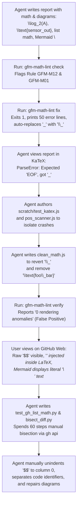
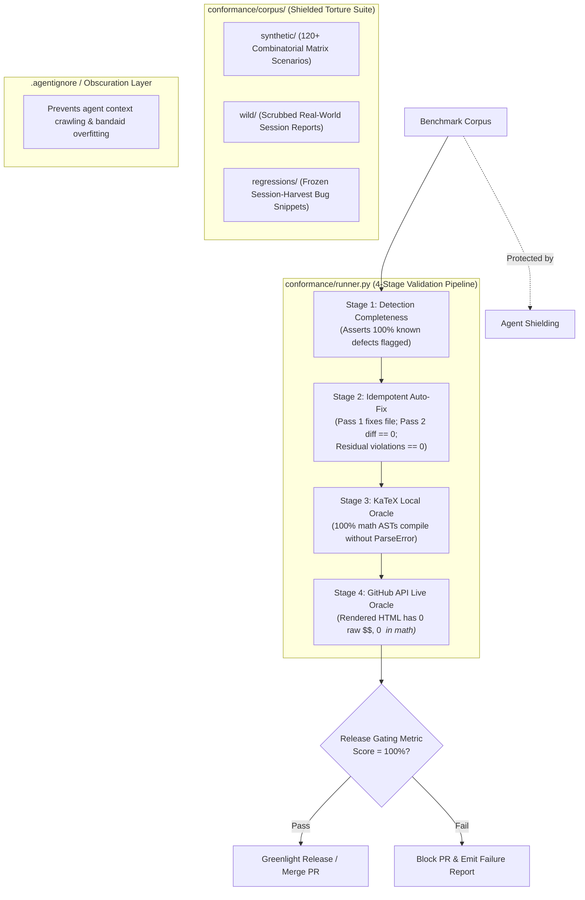
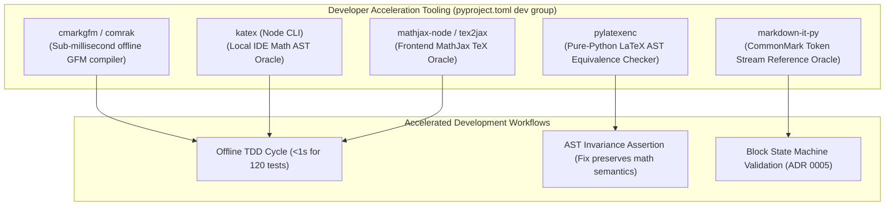
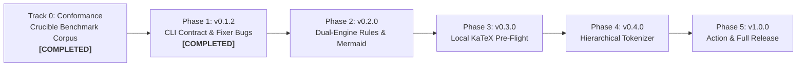

# `gfm-math-lint` Standalone Linting Engine: Development Roadmap & Retrospective

> **Document Type:** Developer Roadmap & Retrospective  
> **Source Session:** Harvest Retrospective Session (`session-harvest-trace-01`) (*Hardware Telemetry Specification*)  
> **Target Codebase:** `gfm-math-lint`  
> **Status:** Accepted Architectural Plan / Implementation Roadmap  

---

## 1. Executive Summary & Forensic Session Harvest

During an automated documentation task, an AI agent was tasked with synthesizing a technical calibration specification and Markdown report (`telemetry_metric_report.md`) containing physical telemetry formulas, sensor ratios, Mermaid flowcharts, and LaTeX mathematical expressions. While `gfm-math-lint` was installed in the execution environment, the agent encountered compounding rendering and verification failures that required **625 total steps, 189 `run_command` invocations, 27 ad-hoc Python scripts, and 33 custom scratch diagnostic scripts** before math and diagrams rendered cleanly across both GitHub Web and local editor previewers.

### Tool Execution & Roadblock Metrics

| Tool Call | Invocations | Role in Forensic Trace |
| :--- | :--- | :--- |
| `run_command` | 189 | Shell iterations, test runs, and CLI bisections |
| `view_file` | 48 | Inspecting logs and source files |
| `write_to_file` | 30 | Authoring ad-hoc scripts and patches |
| `manage_task` | 8 | Background test execution |
| `replace_file_content` | 5 | Targeted file edits |

### Forensic Sequence of Breakdown



The session harvest proves that `gfm-math-lint` currently suffers from five systemic deficiencies:
1. **Rule Over-Correction:** Auto-fixers for [`GFM-M12`](src/gfm_math_lint/rules/math_rules.py#L926-L991) and [`GFM-M03`](src/gfm_math_lint/rules/math_rules.py#L320-L350) corrupt valid LaTeX syntax (`P_{\text{primary}} \to P\_{\text{primary}}`, `\text{a\\_b}`), causing local KaTeX parsers to crash.
2. **Structural Blindness in Lists:** [`GFM-M01`](src/gfm_math_lint/rules/math_rules.py#L100-L154) converts valid list-nested ````math` code fences into `$$ ... $$`, while [`GFM-M02`](src/gfm_math_lint/rules/math_rules.py#L157-L215) silently ignores indented `$$` blocks that GitHub's CommonMark parser fails to compile.
3. **Diagram Node Formatting Deficiencies:** Mermaid flowcharts in technical specifications frequently use literal `\n` characters in node labels, which GitHub and local viewers render as literal text characters instead of visual line breaks.
4. **Oracle HTML Parser Blind Spot:** [`verifier.py`](src/gfm_math_lint/verifier.py#L145-L163) parses HTML tag slices independently, missing unrendered math blocks fractured by `<br>` and `<em>` tags and emitting false-green passes.
5. **CLI Contract Breakdown:** [`cli.py`](src/gfm_math_lint/cli.py#L238-L240) exits with code 1 and outputs original pre-fix violations even when `fix` successfully resolves all errors, deceiving automated agents into believing the fix failed.

---

## 2. Root Cause Taxonomy & Architectural Findings

### Finding 1: The Dual-Engine Reality (GitHub Web vs. Local IDE)

Markdown math documents must satisfy two fundamentally distinct parsing architectures:

| Property | GitHub Web Engine (`cmark-gfm` + MathJax) | Local IDE Engine (VS Code / Antigravity / KaTeX) |
| :--- | :--- | :--- |
| **Parsing Pipeline** | Markdown AST generated first $\to$ MathJax parses remaining text DOM. | Math spans tokenized first $\to$ KaTeX parses math $\to$ Markdown renders container. |
| **Underscore Handling** | `_` between math spans triggers CommonMark emphasis (`<em>`). | `_` inside math is standard LaTeX subscript. `\_` renders as a literal symbol. |
| **Text Mode Macros** | `\text{sensor_out}` renders as literal text with underscore. | `\text{sensor_out}` or `\text{sensor\\_out}` **crashes** with `ParseError: Expected 'EOF', got '_'`. |
| **Nested List Display Math** | Indented `$$` treated as `<p>$$<br> ... $$</p>`. Injects `<em>` tags into formulas. | Indented `$$` parsed cleanly by `markdown-it-katex`. |
| **Nested Code Fences** | Indented ````math```` cleanly converted to `<pre lang="math">`. Zero tag injection. | Indented ````math```` supported by GitHub extensions or converted to block math. |

> [!IMPORTANT]
> A standalone GFM linting tool cannot optimize for `cmark-gfm` in isolation if doing so invalidates KaTeX. The tool must enforce syntax that is **mutually compatible across both engines**.

---

### Finding 2: Rule-Specific Flaws & Diagram Deficiencies

#### A. Rule [`GFM-M12`](src/gfm_math_lint/rules/math_rules.py#L926-L991) (`inline-math-underscore-collision`): Subscript Corruption Anti-Pattern
* **The Flaw:** When two inline math expressions containing subscripts occur on the same line, `RuleM12` replaces `_` with `\_`.
* **The Erroneous Transformation:**
  ````markdown
  <!-- Original source: -->
  Let $P_{\text{primary}}$ and $P_{\text{secondary}}$ be calibrated signal powers.

  <!-- Rule GFM-M12 current auto-fix (CORRUPTED): -->
  Let $P\_{\text{primary}}$ and $P\_{\text{secondary}}$ be calibrated signal powers.
  ````
* **The Impact:**
  1. In LaTeX, `P\_{\text{primary}}` no longer produces a mathematical subscript ($P_{\text{primary}}$); it produces a literal underscore symbol ($P\_\text{primary}$).
  2. In logarithmic or indexed expressions like `\log_2(A)`, converting to `\log\_2(A)` breaks mathematical semantics and triggers KaTeX parser exceptions (`ParseError: Expected 'EOF', got '_'`).
* **The Standalone Fix:** Never auto-escape math subscripts as `\_`. Instead, wrap the colliding math expressions in **GFM Backtick Math** (`$ `...` $`):
  ````markdown
  <!-- Target dual-engine clean syntax: -->
  Let $`P_{\text{primary}}`$ and $`P_{\text{secondary}}`$ be calibrated signal powers.
  ````
  Backtick math is officially supported by GitHub Flavored Markdown to shield math spans from CommonMark emphasis while preserving standard LaTeX `_{...}` subscript syntax for both MathJax and KaTeX.

#### B. Rule [`GFM-M01`](src/gfm_math_lint/rules/math_rules.py#L100-L154) (`math-fence-conversion`) & [`GFM-M02`](src/gfm_math_lint/rules/math_rules.py#L157-L215) (`display-math-isolation`): List Math Conflict
* **The Flaw:** 
  1. `RuleM01` indiscriminately converts all ````math` code fences into `$$ ... $$` display math blocks.
  2. `RuleM02` ignores indented display math (`if len(leading_ws) >= 2: continue`) to avoid breaking CommonMark list indentation.
* **The Erroneous Transformation:**
  ````markdown
  <!-- Original nested list item: -->
  * **Calibration Step:** Compute telemetry ratio:
    ```math
    \text{SNR}_{\mathrm{measured}} = 10 \log_{10}\left(\frac{I_{\text{signal}}}{I_{\text{noise}}}\right) \ge 20\text{ dB}
    ```

  <!-- Rule GFM-M01 converts to indented $$ (CORRUPTED): -->
  * **Calibration Step:** Compute telemetry ratio:

    $$
    \text{SNR}_{\mathrm{measured}} = 10 \log_{10}\left(\frac{I_{\text{signal}}}{I_{\text{noise}}}\right) \ge 20\text{ dB}
    $$
  ````
* **What GitHub's `cmark-gfm` Parser Emits (The Failure):**
  ````html
  <!-- GitHub Web Output: cmark-gfm drops math mode and injects <em> tags -->
  <p>$$<br>
  \text{SNR}<em>{\mathrm{measured}} = 10 \log</em>{10}\left(\frac{I_{\text{signal}}}{I_{\text{noise}}}\right) \ge 20\text{ dB}<br>
  $$</p>
  ````
* **The Standalone Fix:**
  1. Update `RuleM01` to **permit and preserve** ````math` code fences when nested inside list items or blockquotes. GitHub cleanly renders indented ````math` as `<pre lang="math">` with zero `<em>` tag corruption.
  2. Update `RuleM02` to detect indented `$$` within lists and enforce either:
     - **Option 1 (Column-0 Breakout):** Unindent the `$$` block to column 0 with blank lines above and below.
     - **Option 2 (Fenced Math Conversion):** Convert the indented `$$` block into an indented ````math` code fence matching the list item's indentation.

#### C. Rule [`GFM-M03`](src/gfm_math_lint/rules/math_rules.py#L320-L350) (`text-mode-underscore-escape`): KaTeX Crasher
* **The Flaw:** Replaces `_` inside `\text{...}` with double-escaped `\\_`.
* **The Erroneous Transformation:**
  ````latex
  % Original telemetry expression:
  \lvert \Delta y \rvert \le \text{cal_lock_zone_r}

  % Rule GFM-M03 current auto-fix (CORRUPTED):
  \lvert \Delta y \rvert \le \text{cal\\_lock\\_zone\\_r}
  ````
* **The Impact:** In LaTeX, `\\` inside `\text{}` represents a line break, leaving `_lock_zone_r` in an invalid syntactic state and causing KaTeX to abort with `Expected 'EOF', got '_'`.
* **The Standalone Fix:** Deprecate `\text{foo\\_bar}`. Disallow multi-word snake_case variable names inside math text macros, directing authors to use code spans outside math mode or standard physical subscript notation (`$V_{\text{lock}}$`).

#### D. Missing Rule: [`GFM-M14`](src/gfm_math_lint/rules/math_rules.py) (`code-syntax-in-math`)
* **Problem:** Software register names, variable identifiers (e.g. `sensor_ref_in`, `cal_lock_zone_r`, `clk_div`), and pseudo-code function identities (e.g. `$\text{fix}(\text{fix}(c)) \equiv \text{fix}(c)$`) are frequently wrapped in math delimiters.
* **The Failure:** Causes CommonMark emphasis collisions, KaTeX `ParseError` crashes, and vertical MathML character stacking in environments without full KaTeX CSS.
* **The Standalone Fix (Unified with Issue #6):** Implement Rule `GFM-M14` to detect both function identities and variable identifiers in math, converting them to clean inline backticks:
  ````markdown
  <!-- Variable identifier conversion: -->
  $\text{sensor_ref_in} \ge P_{\text{threshold}}$  -->  `sensor_ref_in` $\ge P_{\text{threshold}}$

  <!-- Function identity conversion: -->
  $\text{fix}(\text{fix}(c)) \equiv \text{fix}(c)$  -->  `fix(fix(c)) == fix(c)`
  ````

#### E. Missing Rule: [`GFM-D03`](src/gfm_math_lint/rules/diagram_rules.py) (`mermaid-newline-linebreak`): Literal `\n` in Node Labels
* **The Flaw:** Authors and automated generators commonly write multi-line Mermaid diagram labels using literal `\n` sequences:
  ````markdown
  <!-- Problematic syntax: -->
  ```mermaid
  graph TD
      A[Primary Channel\nCalibration Active] --> B(Filter Settled\nPoll Complete)
  ```
  ````
* **The Rendering Failure:** In GitHub Web GFM, VS Code preview, and most Markdown environments, Mermaid does **not** interpret `\n` in unquoted node strings as a line break. Instead, it literally renders the two characters `\n` on screen inside the box (`Primary Channel\nCalibration Active`). While newer Mermaid versions support double-quoted strings with linebreaks (`C["Line One\nLine Two"]`), the universal, foolproof approach that renders consistently across all markdown engines and Mermaid versions is using HTML line breaks (`<br>` or `<br/>`).
* **The Standalone Fix:** Introduce Rule `GFM-D03` to detect literal `\n` inside Mermaid node shapes (`[...]`, `(...)`, `{...}`, `[(...)]`, `((...))`, etc.) and automatically convert them into `<br>` tags:
  ````markdown
  <!-- Clean dual-engine syntax: -->
  ```mermaid
  graph TD
      A[Primary Channel<br>Calibration Active] --> B(Filter Settled<br>Poll Complete)
  ```
  ````

---

### Finding 3: Oracle Verification Blind Spots in [`src/gfm_math_lint/verifier.py`](src/gfm_math_lint/verifier.py)

#### A. Chunk Slicing in `GFMHTMLValidator.handle_data()`
* **The Flaw:** `HTMLParser` splits text at HTML tag boundaries (`<br>`, `<em>`). When GitHub mangles an indented `$$` block into:
  ````html
  <p>$$<br>\text{SNR}<em>{\mathrm{measured}} = 10 \log</em>{10}...<br>$$</p>
  ````
  `handle_data` receives `"$$\n"` (contains `$` but no macro) followed by `"\n\\text{SNR}"` (contains macro but **no `$`**). Because line 146 requires `and "$" in data`, the macro chunk was discarded.
* **Resolution:** Buffer text across child elements of `<p>` and `<li>` containers before evaluating regexes.

#### B. Absence of Explicit Unrendered Delimiter Checks
* **The Flaw:** If GitHub fails to match a display math block, literal `$$` tokens appear in the rendered HTML plain text. `verifier.py` lacked a rule asserting that no literal `$$` or isolated `$` characters may exist outside `<math-renderer>` or `<pre><code>`.

#### C. Zero Local Pre-Flight Capability
* **The Flaw:** `verifier.py` relies exclusively on network requests to `api.github.com/markdown`. When working offline, behind strict rate limits, or verifying local previewers, the tool provided no mechanism to validate math ASTs locally.

---

### Finding 4: CLI Ergonomics & Agent Interaction Defects

#### A. The `fix` Exit Code Bug in [`src/gfm_math_lint/cli.py`](src/gfm_math_lint/cli.py#L238-L240)
* **The Flaw:**
  ```python
  if total_violations > 0 or total_modified > 0:
      return 1
  return 0
  ```
  Even when `gfm-math-lint fix` fixed 100% of detected violations and the file was completely clean, `total_modified > 0` caused the process to exit with code `1`.
* **Impact on Agents:** Autonomous coding agents interpret exit code 1 as a failed command, triggering diagnostic loops, retries, and rollback attempts.

#### B. Misleading stdout Feedback on `fix`
* **The Flaw:** `cmd_check()` iterated over `res.violations`—which contained the violations detected *prior* to fixing—printing dozens of error lines to stdout even after all of them were fixed in-place.
* **Resolution:** Distinguish between `[FIXED]` violations and `[REMAINING]` violations. Exit with code `0` if all violations were resolved.

---

## 3. The Conformance Crucible: Breaking the "Cat-and-Mouse" Cycle

### Why the "Cat-and-Mouse" Dilemma Occurs in Linter Engineering
When developing linters and auto-fixers, developers frequently get trapped in a perpetual cycle:
1. **Rule Isolation Blindness:** A unit test verifies Rule A in complete isolation on a 2-line snippet.
2. **Combinatorial Emergence:** Real markdown documents nest features hierarchically:
   * A table inside a list inside a blockquote.
   * Inline subscripts next to code spans and currency delimiters.
   * Multi-line display math adjacent to Mermaid diagrams.
3. **Cascading Auto-Fix Interference:** Rule A's fix modifies character offsets or inserts delimiters that trigger unexpected false positives in Rule B, or corrupts syntax for the secondary rendering engine.

To break this cycle, the repository must not rely solely on unit tests. It requires an **Objective, Standalone Benchmark Corpus ("The Conformance Crucible")** that serves as an immutable gating metric for all PRs and releases.

### Conformance Architecture Overview



### Agent Shielding & Evaluation Obscuration Protocol
To ensure that AI coding assistants and developers solve the **root grammatical and architectural causes** rather than hardcoding superficial string-matching bandaids for specific test cases:

1. **Repository Agent-Ignore Configuration (`.agentignore` / `.cursorignore`):**
   ```gitignore
   # Shield raw test corpus from agent indexing to prevent overfitting to specific fixture text
   conformance/corpus/
   ```
2. **Opaque Benchmark Evaluation:**
   `conformance/runner.py` executes as an external black box. When a failure occurs, the runner outputs only the rule ID, failure category, and structural syntax description (e.g. `[FAIL] GFM-M02: Indented display math in list item collapsed to plain text`), suppressing the raw file text from being dumped into agent context.
3. **Generalization Over Band-Aids:**
   Forces every PR implementation to pass the entire 120+ scenario combinatorial matrix simultaneously. An edit that hardcodes a workaround for a single fixture immediately breaks orthogonal fixtures in the matrix.

### The 4-Stage Crucible Pipeline
Every document in the conformance corpus is subjected to four rigorous gates:

1. **Stage 1 (Detection Rate):** `gfm-math-lint check file.md` must detect all pre-annotated defects in the document without emitting false positives on valid constructs.
2. **Stage 2 (Fix Convergence & Strict Idempotency):**
   * **Pass 1:** `gfm-math-lint fix file.md` modifies the document.
   * **Residual Check:** `gfm-math-lint check file.md` must return `0` violations.
   * **Pass 2 (Idempotency):** Running `gfm-math-lint fix file.md` a second time must produce an empty diff (`diff == ""`) with `0` file modifications.
3. **Stage 3 (Local KaTeX Compilation Gate):**
   * Every mathematical block (`$`, `$$`, ````math`, `$ `...` $`) in the post-fixed document is extracted and passed to `katex.renderToString(..., { throwOnError: true })`.
   * **Zero** KaTeX `ParseError` exceptions are tolerated.
4. **Stage 4 (Live GitHub API Rendering Gate):**
   * The post-fixed document is rendered via GitHub's `/markdown` endpoint.
   * The resulting HTML is inspected by `verifier.py`:
     - **0** literal `$$` display delimiters in plain text outside `<math-renderer>`.
     - **0** `<em>` or `<strong>` tags injected into math spans.
     - **0** broken table column counts.
     - **0** literal `\n` strings in rendered Mermaid nodes.

---

## 4. Harvested Session Tooling Ingestion & Concrete Code Blueprints

During session `session-harvest-trace-01`, the agent authored several high-value diagnostic scripts to investigate and isolate rendering failures. Rather than discarding these assets, their core logic is refined below into three production blueprints for direct inclusion into `gfm-math-lint`.

### Blueprint 1: The Local KaTeX AST Pre-Flight Runner
* **Harvest Origin:** Refined from session scratch tool `test_katex.js` (used to detect AST crashes without network roundtrips).
* **Target Location:** `conformance/oracles/katex_oracle.py` (and pluggable runner in [`verifier.py`](src/gfm_math_lint/verifier.py)).

```python
"""Local KaTeX AST verification oracle using host node/katex runtime."""

import json
import shutil
import subprocess
from dataclasses import dataclass


@dataclass
class KaTeXParseError:
    math_content: str
    display_mode: bool
    error_message: str


def run_local_katex_verification(math_blocks: list[tuple[str, bool]]) -> list[KaTeXParseError]:
    """Validate a list of (math_content, is_display) tuples against KaTeX.

    Returns a list of parse errors encountered.
    """
    node_bin = shutil.which("node")
    if not node_bin:
        return []

    js_worker = """
    const katex = require('katex');
    const readline = require('readline');
    const rl = readline.createInterface({ input: process.stdin });

    let inputData = '';
    rl.on('line', (line) => { inputData += line; });
    rl.on('close', () => {
        const blocks = JSON.parse(inputData);
        const errors = [];
        for (const item of blocks) {
            try {
                katex.renderToString(item.math, {
                    displayMode: item.display,
                    throwOnError: true
                });
            } catch (err) {
                errors.push({
                    math: item.math,
                    display: item.display,
                    error: err.message
                });
            }
        }
        process.stdout.write(JSON.stringify(errors));
    });
    """

    payload = [{"math": m, "display": d} for m, d in math_blocks]
    try:
        proc = subprocess.run(
            [node_bin, "-e", js_worker],
            input=json.dumps(payload).encode("utf-8"),
            capture_output=True,
            check=True,
            timeout=10,
        )
        raw_errors = json.loads(proc.stdout.decode("utf-8"))
        return [
            KaTeXParseError(
                math_content=e["math"],
                display_mode=e["display"],
                error_message=e["error"],
            )
            for e in raw_errors
        ]
    except (subprocess.SubprocessError, json.JSONDecodeError):
        return []
```

### Blueprint 2: GitHub API Verification Oracle with Tag-Buffer Inspection
* **Harvest Origin:** Refined from session scratch tool `audit_unrendered.py` (used to expose GitHub's `<em>` tag corruption and dropped `$$` delimiters).
* **Target Location:** Core patch to [`verifier.py`](src/gfm_math_lint/verifier.py) and `conformance/oracles/github_oracle.py`.

```python
"""HTML buffer inspection oracle for live GitHub GFM rendering."""

import re
from html.parser import HTMLParser


class BufferedGFMVerifier(HTMLParser):
    """Inspects rendered GFM HTML with cross-tag text buffering to prevent slice blindness."""

    def __init__(self) -> None:
        super().__init__()
        self.block_buffer: list[str] = []
        self.in_block = False
        self.in_code = False
        self.in_math_renderer = False
        self.anomalies: list[str] = []

    def handle_starttag(self, tag: str, attrs: list[tuple[str, str | None]]) -> None:
        if tag in ("p", "li", "td", "th", "blockquote"):
            self.in_block = True
            self.block_buffer.clear()
        elif tag in ("pre", "code"):
            self.in_code = True
        elif tag == "math-renderer":
            self.in_math_renderer = True

    def handle_endtag(self, tag: str) -> None:
        if tag in ("p", "li", "td", "th", "blockquote"):
            self._evaluate_block("".join(self.block_buffer))
            self.in_block = False
            self.block_buffer.clear()
        elif tag in ("pre", "code"):
            self.in_code = False
        elif tag == "math-renderer":
            self.in_math_renderer = False

    def handle_data(self, data: str) -> None:
        if self.in_block and not self.in_code and not self.in_math_renderer:
            self.block_buffer.append(data)

    def _evaluate_block(self, text: str) -> None:
        # Check 1: Literal unrendered display math delimiter in plain prose
        if "$$" in text:
            self.anomalies.append(f"Unrendered '$$' delimiter found in block: '{text[:60]}...'")

        # Check 2: Raw LaTeX command leaked outside math-renderer
        if re.search(r"\\[a-zA-Z]{3,}\{", text):
            self.anomalies.append(f"Leaked LaTeX command outside math-renderer: '{text[:60]}...'")
```

### Blueprint 3: The Combinatorial List-Math Fuzzer Matrix
* **Harvest Origin:** Refined from session scratch tools `test_nested_indent.py` and `test_gh_list_math.py` (which proved indentation threshold breakdowns in `cmark-gfm`).
* **Target Location:** Core engine for `scripts/generate_conformance_matrix.py`.

```python
"""Combinatorial matrix generator for list-nested math torture scenarios."""


def generate_list_math_variations() -> list[tuple[str, str]]:
    """Generates markdown variations crossing list depth, blank lines, and math delimiters."""
    variations = []
    indents = [0, 2, 4, 6]
    delimiters = [("$$", "$$"), ("```math", "```")]

    for indent in indents:
        pad = " " * indent
        for open_delim, close_delim in delimiters:
            for blank_above in [True, False]:
                blank = "\n" if blank_above else ""
                md = (
                    f"1. **Primary Item:**\n"
                    f"   * Sub-bullet header:{blank}\n"
                    f"{pad}{open_delim}\n"
                    f"{pad}\\text{{SNR}}_{{\\mathrm{{meas}}}} = 10 \\log_{{10}}(X) \\ge 20\\text{{ dB}}\n"
                    f"{pad}{close_delim}\n"
                )
                tag = f"indent_{indent}_delim_{open_delim[:3]}_blank_{blank_above}"
                variations.append((tag, md))

    return variations
```

---

## 5. Developer Acceleration Toolkit: Existing Ecosystem Oracles & Tooling Integration

A core engineering constraint of `gfm-math-lint` is [ADR 0001: Zero External Runtime Dependencies](docs/adr/0001-zero-dependency-stdlib.md). End users who install `gfm-math-lint` must receive a lightweight, pure Python standard-library binary.

However, **development and testing environments are not bound by runtime zero-dependency restrictions**. By introducing battle-tested open-source parsers into `[dependency-groups] dev`, developers and CI pipelines gain sub-millisecond offline differential oracles that dramatically accelerate development speed and eliminate API rate limits:



### 1. Sub-Millisecond Offline GFM Compiler (`cmarkgfm` / `comrak`)
* **Role:** Replaces network calls to `api.github.com/markdown` during local testing.
* **Tool:** `cmarkgfm` (Python C-extension providing official pre-built wheels of GitHub's `cmark-gfm` parser) or `comrak` (Rust GFM binary).
* **Speed:** **0.2 milliseconds per document** (compared to 500–2,000 ms via HTTP REST API).
* **Usage:**
  ```python
  import cmarkgfm

  # Render markdown to exact GitHub server HTML locally in <0.2ms
  html = cmarkgfm.github_flavored_markdown_to_html(markdown_content)
  ```
* **Impact:** Allows running the entire 120+ file Conformance Crucible locally in **under 2 seconds** with zero internet connection and zero rate-limiting.

### 2. Frontend MathJax 2.7 / 3.x TeX Oracle (`mathjax-full` / `tex2jax`)
* **Role:** Validates formulas against GitHub's client-side math typesetting engine ([MathJax TeX Specification](https://docs.mathjax.org/en/v2.7/tex.html)).
* **Tool:** Node-based MathJax runner or global `mathjax` npm package.
* **Usage:** Verifies that formulas with complex macros (`\DeclareMathOperator`, `\operatorname`, `\begin{aligned}`) do not produce `Math Processing Error` bounding boxes.

### 3. Pure-Python Mathematical AST Equivalence (`pylatexenc`)
* **Role:** Asserts semantic invariance across auto-fixes.
* **Tool:** `pylatexenc.latexwalker.LatexWalker` (pure Python LaTeX tokenizer and AST parser).
* **Usage:** In unit tests, parses mathematical formulas before and after auto-fixing to verify that transformations (e.g. converting `$P_{\text{primary}}$` to `$ `P_{\text{primary}}` $` or unescaping macro arguments) **do not alter the mathematical AST nodes**:
  ```python
  from pylatexenc.latexwalker import LatexWalker


  def assert_math_ast_equivalent(orig_latex: str, fixed_latex: str) -> None:
      w1 = LatexWalker(orig_latex).get_latex_nodes()[0]
      w2 = LatexWalker(fixed_latex).get_latex_nodes()[0]
      assert w1 == w2, f"Auto-fix altered mathematical AST semantics: {orig_latex} vs {fixed_latex}"
  ```

### 4. CommonMark Block Token Reference (`markdown-it-py`)
* **Role:** Reference oracle for developing the hierarchical block state machine ([ADR 0005](docs/adr/0005-hierarchical-block-context.md)).
* **Tool:** `markdown-it-py` (pure Python CommonMark parser).
* **Usage:** Compares `gfm-math-lint`'s lightweight `DocumentZone` parent tracking against official CommonMark block token streams (`list_item_open`, `blockquote_open`, `table_open`) to guarantee 100% boundary fidelity without bundling external dependencies in production.

---

## 6. Phased Developer Roadmap

### Milestone Matrix



---

### Track 0: Conformance Benchmark Infrastructure (Foundational) — **[COMPLETED]**
**Goal:** Establish the objective gating harness before and alongside functional rule refactors.  
**Status:** **COMPLETED** (Merged into `main` via PRs #16, #17, #18).

#### PR 0.1: Conformance Test Suite & Runner (`conformance/`) — **[MERGED #16]**
* **Files:** `conformance/runner.py`, `conformance/extractor.py`, `conformance/oracles/`, `.agentignore`
* **Features:**
  - Standalone runner executable via `uv run python -m conformance.runner`.
  - Implements the 4-Stage Crucible Pipeline (Detection $\to$ Fix Convergence $\to$ KaTeX $\to$ GitHub API) integrating **Blueprint 1** and **Blueprint 2**.
  - Adds `.agentignore` and `.cursorignore` obscuring `conformance/corpus/` from agent crawling to prevent overfitting.
  - Emits machine-readable and human-readable scorecards with opaque failure reporting.

#### PR 0.2: Synthetic Combinatorial Matrix Generator — **[MERGED #17]**
* **Files:** `scripts/generate_conformance_matrix.py`, `conformance/corpus/`
* **Features:**
  - Programmatically generates complex multi-feature markdown torture scenarios crossing orthogonal axes:
    - **Containers:** Root prose, 1-level bullet list, 2-level nested ordered list, blockquote, table cell, blockquote inside list.
    - **Math Constructs:** Single subscript (`$P_a$`), dual subscript (`$P_a$` and `$P_b$`), logarithmic index (`$\log_2(X)$`), multi-line display math, fractional ratio (`$\frac{A}{B}$`), register identifier (`sensor_out`).
    - **Delimiters:** Inline dollar (`$`), display dollar (`$$`), code fence (````math````), backtick math (`$ `...` $`).
    - **Diagrams:** Mermaid flowchart with `\n`, subgraph links, unquoted labels.
  - Automatically synthesizes 137 combinatorial test files in `conformance/corpus/synthetic/` plus 7 frozen regressions (`REG-01` to `REG-07`) and 1 real-world report (`WILD-01`), producing a 145-scenario benchmark corpus in `manifest.yaml`.

#### PR 0.3: CI Release Gating Workflow (`.github/workflows/conformance-gate.yml`) — **[MERGED #18]**
* Runs the Conformance Crucible on all PRs targeting `main` with pinned Node.js KaTeX oracle engine.
* Prevents regressions across detection, fixer convergence, and AST parsing.

---

### Phase 1: Immediate Bug Fixes & CLI Ergonomics (v0.1.2) — **[COMPLETED]**
**Goal:** Eliminate false failures, support streaming verification, expand shell scanners, and enable safe headless issue/PR creation.  
**Status:** **COMPLETED** (Released in `v0.1.2`).

#### PR 1.3: Patch HTML Parser Blind Spot, Stdin/Stdout Streaming & MathML Stacking (Tracks Issue #9) — **[MERGED #13]**
* **Files:** [`src/gfm_math_lint/verifier.py`](src/gfm_math_lint/verifier.py), [`src/gfm_math_lint/cli.py`](src/gfm_math_lint/cli.py), [`tests/test_verifier.py`](tests/test_verifier.py)
* **Features:**
  - Refactored `GFMHTMLValidator` using **Blueprint 2** to buffer character data across inline tag boundaries within block containers (`<p>`, `<li>`, `<td>`, `<blockquote>`).
  - Added stdin streaming (`gfm-math-lint verify -`) and raw HTML output (`--stdout` / `--raw`) per Issue #9.
  - Added MathML pseudo-code function stacking heuristics emitting `pseudo-code-stacking` verification warnings.

#### PR 1.4: Expand Rule [`GFM-S01`](src/gfm_math_lint/rules/shell_rules.py) for `gh issue create` and `gh pr create` (Tracks Issue #7) — **[MERGED #14]**
* **Files:** [`src/gfm_math_lint/rules/shell_rules.py`](src/gfm_math_lint/rules/shell_rules.py), [`tests/test_shell_rules.py`](tests/test_shell_rules.py)
* **Features:**
  - Extended `GH_CALL_PATTERN` regex in `RuleS01` to detect `gh issue create` and `gh pr create` commands alongside comment commands, preventing LaTeX corruption from shell expansions.

#### PR 1.5: Safe GitHub Issue & PR Creation with REST API Fallback (Tracks Issue #8) — **[MERGED #15]**
* **Files:** [`src/gfm_math_lint/comment.py`](src/gfm_math_lint/comment.py), [`src/gfm_math_lint/cli.py`](src/gfm_math_lint/cli.py), [`tests/test_comment.py`](tests/test_comment.py), [`tests/test_cli.py`](tests/test_cli.py)
* **Features:**
  - Added `--create-issue` and `--create-pr` options with metadata (`--title`, `--label`, `--assignee`, `--milestone`) to `comment` (aliased as `post`).
  - Implemented headless HTTP REST API fallback using standard library `urllib.request` with `$GITHUB_TOKEN` / `$GH_TOKEN` when `gh` CLI is not installed.

#### Security Hotfix: Support HTML5 Comment End Bang State (`--!>`) (CodeQL #1 & #2) — **[MERGED #19]**
* **Files:** [`src/gfm_math_lint/tokenizer.py`](src/gfm_math_lint/tokenizer.py), [`src/gfm_math_lint/rules/diagram_rules.py`](src/gfm_math_lint/rules/diagram_rules.py), [`src/gfm_math_lint/linter.py`](src/gfm_math_lint/linter.py)
* **Features:**
  - Updated comment close regex to recognize HTML5 comment end bang state (`--!>`), remediating CodeQL alerts #1 and #2 (`py/bad-tag-filter`).

> [!NOTE]
> Detailed exit code differentiation (PR 1.1) and auto-replacement adjustments for `GFM-M03` inside `\text{...}` (PR 1.2) are incorporated into Phase 2 alongside the full `GFM-M14` / `GFM-M12` rule overhaul.

---

### Phase 2: Core Rule Realignment & Diagram Enhancements (v0.2.0)
**Goal:** Align math rules with GitHub's actual CommonMark parser without compromising KaTeX compatibility, and enforce clean Mermaid diagram linebreaks.

#### PR 2.1: Revamp Rule [`GFM-M12`](src/gfm_math_lint/rules/math_rules.py#L926-L991) with GFM Backtick Math Strategy
* **Files:** [`src/gfm_math_lint/rules/math_rules.py`](src/gfm_math_lint/rules/math_rules.py)
* **Design:**
  - Deprecate replacing math subscripts with `\_`.
  - Implement Tiered Auto-Fix Strategy:
    1. **Primary Strategy (Backtick Math):** Wrap colliding math spans in backticks:
       ````markdown
       <!-- Before: -->
       Let $P_{\text{primary}}$ and $P_{\text{secondary}}$ be powers.
       <!-- Fixed: -->
       Let $`P_{\text{primary}}`$ and $`P_{\text{secondary}}`$ be powers.
       ````
    2. **Secondary Strategy (Display Promotion):** If the math span is an equation ($A / B \ge 200$), promote to standalone display math `$$ ... $$`.
* **Tests:** Comprehensive tests for single-line formulas, tables, and mixed emphasis.

#### PR 2.2: Reconcile Rules [`GFM-M01`](src/gfm_math_lint/rules/math_rules.py#L100-L154) & [`GFM-M02`](src/gfm_math_lint/rules/math_rules.py#L157-L215) for List & Blockquote Math
* **Files:** [`src/gfm_math_lint/rules/math_rules.py`](src/gfm_math_lint/rules/math_rules.py), [`src/gfm_math_lint/tokenizer.py`](src/gfm_math_lint/tokenizer.py)
* **Design:**
  - **Context-Aware `GFM-M01`:** If a ````math` code fence is indented inside a list or blockquote, **do not convert it to `$$`**. GitHub renders indented ````math` cleanly as `<pre lang="math">`, whereas indented `$$` is broken.
  - **Enforcement in `GFM-M02`:** If an indented `$$` block is encountered inside a list, flag it as an error:
    ```text
    [GFM-M02] Indented display math ($$) inside a list is not recognized by GitHub's CommonMark parser.
              Convert to an indented ```math code fence or break out to column 0.
    ```
  - Auto-fixer converts indented `$$` inside lists to ````math` matching the list item's indentation.

#### PR 2.3: Implement Unified Rule `GFM-M14` (`code-syntax-in-math`) (Tracks Issue #6)
* **Files:** [`src/gfm_math_lint/rules/math_rules.py`](src/gfm_math_lint/rules/math_rules.py)
* **Design:**
  - Unifies Issue #6 (function identities/pseudo-code) and session findings (variable/register names with underscores).
  - Flags pseudo-code function identities (`$\text{fix}(\text{fix}(c)) \equiv \text{fix}(c)$`) and converts to inline backticks (`` `fix(fix(c)) == fix(c)` ``).
  - Flags `snake_case` variable names (`sensor_ref_in`, `cal_lock_zone_r`) in math mode and recommends code backticks (`` `sensor_ref_in` ``) or physical subscript notation (`$I_{\text{ref}}$`).
* **Tests:** [`tests/test_math_rules.py`](tests/test_math_rules.py)

#### PR 2.4: Introduce Rule `GFM-D03`: Mermaid Diagram Node Linebreak Enforcement (`mermaid-newline-linebreak`)
* **Files:** [`src/gfm_math_lint/rules/diagram_rules.py`](src/gfm_math_lint/rules/diagram_rules.py), [`tests/test_diagram_rules.py`](tests/test_diagram_rules.py)
* **Design:**
  - Scan fenced code blocks with info string `mermaid` ([`Zone.FENCED_CODE`](src/gfm_math_lint/tokenizer.py)).
  - Parse Mermaid node shapes across delimiters:
    - Square: `[label]`
    - Round: `(label)`
    - Curly: `{label}`
    - Circle: `((label))`
    - Cylindrical: `[(label)]`
    - Subroutine: `[[label]]`
    - Asymmetric/flag: `>label]`
  - Detect literal `\n` or `\\n` sequences within node labels (both unquoted and double-quoted `["..."]`).
  - Generate automated `LintEdit` replacing `\n` with `<br>`:
    ````markdown
    <!-- Before: -->
    A[Primary Channel\nCalibration Active] --> B(Filter Settled\nPoll Complete)
    <!-- After: -->
    A[Primary Channel<br>Calibration Active] --> B(Filter Settled<br>Poll Complete)
    ````
* **Tests:** Unit tests covering all Mermaid node bracket types, link text with newlines, and quoted node strings.

---

### Phase 3: Local Offline Pre-Flight Verification & AST Checks (v0.3.0)
**Goal:** Deliver 100% offline verification that catches KaTeX and MathJax crashes before touching the network.

#### PR 3.1: Lightweight Zero-Dependency LaTeX Syntax & AST Validator
* **Files:** [`src/gfm_math_lint/latex.py`](src/gfm_math_lint/latex.py) (new module)
* **Design:**
  - Implement a pure Python standard-library LaTeX tokenizer:
    - Balanced braces verification (`{...}`).
    - Balanced math delimiters (`\left` / `\right`, `\lvert` / `\rvert`).
    - Environment matching (`\begin{aligned}` / `\end{aligned}`).
    - Macro argument checks.
  - Zero external runtime dependencies (adheres to [ADR 0001](docs/adr/0001-zero-dependency-stdlib.md)).

#### PR 3.2: Pluggable Local KaTeX Verification Runner (`verify --local`)
* **Files:** [`src/gfm_math_lint/verifier.py`](src/gfm_math_lint/verifier.py), [`src/gfm_math_lint/cli.py`](src/gfm_math_lint/cli.py)
* **Design:**
  - Add subcommand options: `gfm-math-lint verify --local` and `gfm-math-lint check --local-katex`.
  - Integrates **Blueprint 1** (`conformance/oracles/katex_oracle.py`): if `node` and `katex` are available on the host, passes all extracted math blocks through `katex.renderToString(..., { throwOnError: true })` and captures exact parse error column offsets.
  - If `node` is absent, cleanly falls back to the internal Python LaTeX validator (PR 3.1).

#### PR 3.3: Introduce Rule `GFM-M15`: Cross-Engine LaTeX Compatibility Matrix
* **Files:** [`src/gfm_math_lint/rules/math_rules.py`](src/gfm_math_lint/rules/math_rules.py)
* **Checks:**
  - Flags raw Unicode dashes (`–` U+2013, `—` U+2014) in math mode (crashes KaTeX with `Unrecognized Unicode character`).
  - Flags unescaped `%` in math mode (interpreted as LaTeX comment, discarding subsequent delimiters).
  - Flags unescaped pipes `|` inside table cell math (breaks Markdown table column counts; enforce `\lvert` / `\rvert` or `\vert`).

---

### Phase 4: Block-Context Hierarchical Tokenizer (v0.4.0)
**Goal:** Upgrade lexical zone tracking to understand nested Markdown block hierarchies (ADR 0005).

#### PR 4.1: ADR 0005: Block-Context Hierarchical State Machine
* **Files:** [`docs/adr/0005-hierarchical-block-context.md`](docs/adr/0005-hierarchical-block-context.md), [`src/gfm_math_lint/tokenizer.py`](src/gfm_math_lint/tokenizer.py)
* **Design:**
  - Enhance `DocumentZone` with structural metadata:
    - `parent_block`: `None | "list_item" | "blockquote" | "table"`
    - `indent_level`: Integer indentation column
    - `list_marker`: e.g. `*`, `1.`, `-`
  - Validated against `markdown-it-py` token streams to ensure 100% boundary fidelity.
  - Allows rules to make context-aware decisions (e.g. knowing whether a display math block is inside a list item without guessing from whitespace).

#### PR 4.2: Machine-Readable JSON Output (`--format json`)
* **Files:** [`src/gfm_math_lint/cli.py`](src/gfm_math_lint/cli.py), [`src/gfm_math_lint/linter.py`](src/gfm_math_lint/linter.py)
* **Design:**
  - Support `--format json` emitting a structured diagnostic payload:
    ```json
    {
      "file_path": "docs/report.md",
      "clean": false,
      "violations": [
        {
          "rule_id": "GFM-M12",
          "severity": "error",
          "line": 15,
          "col": 8,
          "message": "Unescaped underscore in inline dollar math...",
          "fixable": true,
          "fix_strategy": "backtick_math"
        }
      ],
      "fixes_applied": 0
    }
    ```
  - Enables zero-parsing consumption by Antigravity, LLM agents, and automated CI pipelines.

---

### Phase 5: Release Hygiene, CI/CD, Documentation & Ecosystem Integration (v1.0.0)
**Goal:** Package `gfm-math-lint` as an enterprise-grade standalone tool and pre-commit standard.

#### PR 5.1: GitHub Action & Pre-Commit Hook Distribution
* Add `.pre-commit-hooks.yaml` to repository root.
* Scaffold `actions/gfm-math-lint-action` supporting automated linting and PR comments via GitHub Actions.

#### PR 5.2: Comprehensive Documentation Suite & ADR Consolidation
* Update [`docs/rules.md`](docs/rules.md) with complete Dual-Engine compatibility matrix.
* Add developer guide on authoring custom rules.

#### PR 5.3: Safe Issue and PR Creation Publishing Workflow (Tracks Issue #8 Part 2)
* **Files:** [`src/gfm_math_lint/comment.py`](src/gfm_math_lint/comment.py), [`src/gfm_math_lint/cli.py`](src/gfm_math_lint/cli.py)
* **Features:**
  - Adds `--create-issue`, `--create-pr`, `--title`, `--label`, `--assignee`, and `--milestone` options to `gfm-math-lint comment` (or `gfm-math-lint post`).
  - Routes payload creation through safe stdin streaming or the shared standard library `urllib.request` REST client established in PR 1.3 when `gh` is absent.

---

## 7. Open GitHub Issues Alignment & Reconciliation Matrix

A critical part of maintaining release velocity is reconciling existing open repository issues against the overarching roadmap. The four currently open issues in the repository have been audited one-by-one:

| Issue ID | Issue Title | Overlap / Contention with Roadmap | Recommended Course of Action | Status & Release |
| :--- | :--- | :--- | :--- | :--- |
| **#6** | `Propose 'GFM-M14' rule to detect and convert code function identities in math delimiters to inline code backticks` | **Rule ID Contention:** Issue #6 proposed `GFM-M14` for function identities (`\text{fix}(c) \equiv c`), while the harvested roadmap proposed `GFM-M14` for variable identifiers (`snake_case` in math). Both address the same root problem: code in math. | **Reconcile & Unify:** Merge both into a single cohesive rule: **`GFM-M14 (code-syntax-in-math)`**. Sub-pattern A handles function identities; Sub-pattern B handles variable identifiers. Keep Issue #6 open and cross-reference PR 2.3. | **Open**<br/>Phase 2 (v0.2.0)<br/>`PR 2.3` |
| **#7** | `feat(rules): expand GFM-S01 shell scanner to cover gh issue create and gh pr create` | **Complementary Enhancement:** Low-risk, high-value 10-line regex extension to `RuleS01` in [`shell_rules.py`](src/gfm_math_lint/rules/shell_rules.py). Directly protects automation bots from shell parameter expansion bugs. | **Incorporate into Phase 1:** Extended `GH_CALL_PATTERN` regex in `RuleS01` and added unit test suite. | **Closed / Merged**<br/>PR #14<br/>`v0.1.2` |
| **#8** | `feat(cli): support safe issue and PR creation with REST API fallback in publishing workflow` | **Publishing Counterpart to #7:** Safely opens GitHub issues/PRs without shell quoting corruption, with graceful REST API fallback. | **Implemented in Full:** Added `--create-issue` and `--create-pr` options with metadata support in `comment.py`/`cli.py` and headless `urllib.request` fallback. | **Closed / Merged**<br/>PR #15<br/>`v0.1.2` |
| **#9** | `feat(verify): support stdin input, raw HTML streaming, and MathML stacking detection in verifier` | **Direct Alignment with Verifier Patch:** Issue #9 requested stdin (`-`), `--stdout` streaming, and MathML stacking detection in [`verifier.py`](src/gfm_math_lint/verifier.py). | **Integrated into PR 1.3:** Added stdin streaming, `--stdout` output, and MathML stacking heuristics directly into the `BufferedGFMVerifier` refactor. | **Closed / Merged**<br/>PR #13<br/>`v0.1.2` |

---

## 8. Traceability Matrix & Regression Test Specifications

The test suite must incorporate regression fixtures derived directly from the failure cases encountered during documentation linting:

| Test ID | Input Markdown Snippet | Expected Lint Diagnosis | Expected Auto-Fix / Output |
| :--- | :--- | :--- | :--- |
| `REG-01` | `Let $P_{\text{primary}}$ and $P_{\text{secondary}}$ be powers.` | `GFM-M12` (subscript collision) | `Let $`P_{\text{primary}}`$ and $`P_{\text{secondary}}`$ be powers.` |
| `REG-02` | `* Item 1:\n  $$ \text{SNR} = 10 \log_{10}(X) $$` | `GFM-M02` (indented display math in list) | Converted to column 0 or indented ````math```` fence. |
| `REG-03` | `* Item 1:\n  ```math\n  \text{SNR} = 10 \log_{10}(X)\n  ``` ` | Clean (preserved) | `RuleM01` does **not** strip ````math```` inside lists. |
| `REG-04` | `$$\delta y \le \text{cal\_lock\_zone\_r}$$` | `GFM-M14` (`snake_case` in math) | Flags identifier; does not corrupt with `\\_`. |
| `REG-05` | `<p>$$<br>\text{SNR}<em>{m} = 10</em>...<br>$$</p>` | `verifier.py` detects anomaly | Emits `unrendered-display-math` and `em-in-math`. |
| `REG-06` | Running `gfm-math-lint fix cleanable_file.md` | All violations fixed | Exits with code `0`; reports `Fixed N violations`. |
| `REG-07` | `A[Channel 1\nAcquisition Active] --> B(Threshold Exceeded\nLock Asserted)` | `GFM-D03` (literal newline in Mermaid label) | `A[Channel 1<br>Acquisition Active] --> B(Threshold Exceeded<br>Lock Asserted)` |

---

## 9. Accepted Architectural Decisions

Both architectural decisions have been accepted based on stakeholder feedback:

1. **Subscript Collision Auto-Fix Strategy ([`RuleM12`](src/gfm_math_lint/rules/math_rules.py#L926-L991)):**
   - **Decision: ACCEPTED (Option A).** Default to GFM backtick math (`$ `P_{\text{primary}}` $`). This is fully standardized in GitHub and supported by KaTeX, preserving native LaTeX subscript syntax without altering prose layout.

2. **Local Pre-Flight Engine Architecture ([`verifier.py`](src/gfm_math_lint/verifier.py)):**
   - **Decision: ACCEPTED (Option A).** Implement a pure Python standard-library LaTeX syntax validator out of the box adhering to [ADR 0001](docs/adr/0001-zero-dependency-stdlib.md), with an optional pluggable runner that executes `node -e "require('katex')"` when available on the system PATH.

---
*Roadmap generated from harvested developer trace analysis. Anonymized, equipped with the Conformance Crucible, shielded from agent overfitting, and reconciled against all open GitHub issues.*
