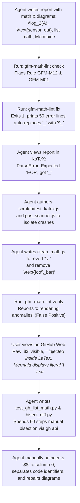
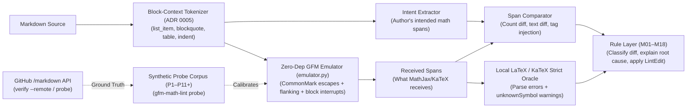
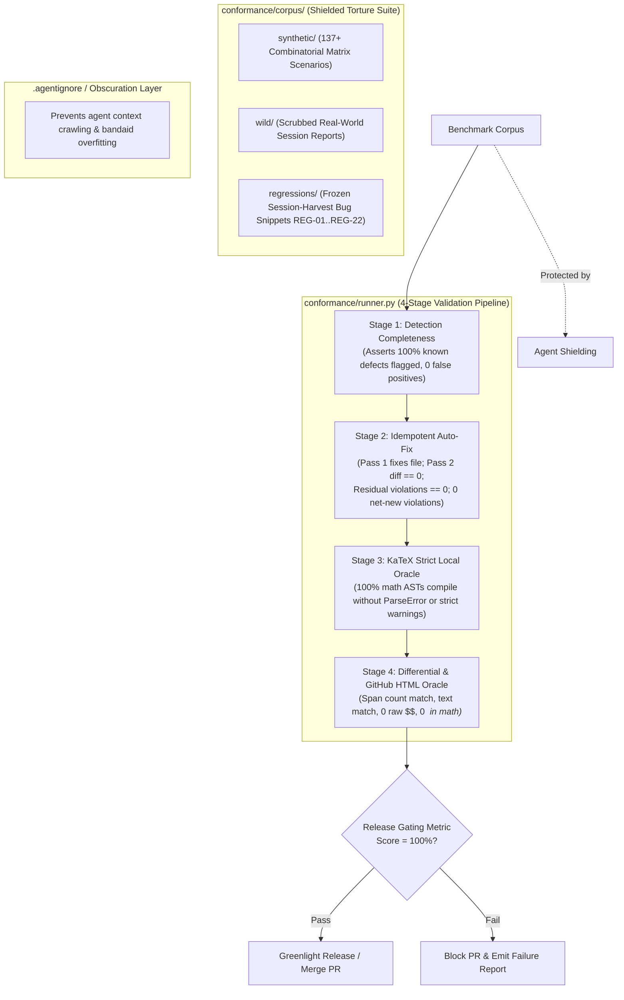
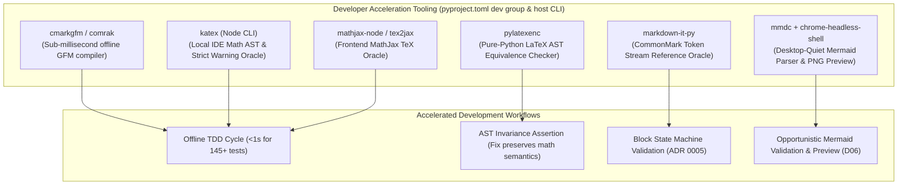
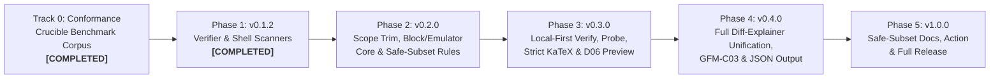

# `gfm-math-lint` Standalone Linting Engine: Development Roadmap & Retrospectives

> **Document Type:** Developer Roadmap, Architectural Plan & Field Retrospectives  
> **Source Sessions:**  
> - **Session 1 (`session-harvest-trace-01`):** *Hardware Telemetry Specification* (Dual-Engine KaTeX vs. GitHub Web Forensics)  
> - **Session 2 (`dual-doc-conversion-2026-11`):** *Converting Two Equation-Heavy Documents to GitHub Math & Mermaid* ([`RETROSPECTIVE_2026-11_dual_doc_session.md`](RETROSPECTIVE_2026-11_dual_doc_session.md))  
> **Target Codebase:** `gfm-math-lint`  
> **Status:** Accepted Architectural Plan / Active Implementation Roadmap (Reconciled Post-`v0.1.2`)  

---

## 1. Executive Summary & Forensic Session Harvests

`gfm-math-lint` is informed by two complementary empirical field retrospectives conducted on real-world, equation- and diagram-heavy engineering documents. Together, these sessions exposed both **cross-engine incompatibilities** (GitHub Web vs. local IDE KaTeX previewers) and **silent GitHub CommonMark pre-processing traps** that neither traditional regex linters nor standalone KaTeX passes catch in isolation.

### 1.1 Session 1 Harvest (`session-harvest-trace-01`): Hardware Telemetry Specification

During an automated documentation task synthesizing a technical calibration specification (`telemetry_metric_report.md`) containing physical telemetry formulas, sensor ratios, Mermaid flowcharts, and LaTeX expressions, the agent encountered compounding rendering and verification failures that required **625 total steps, 189 `run_command` invocations, 27 ad-hoc Python scripts, and 33 custom scratch diagnostic scripts** before math and diagrams rendered cleanly across both GitHub Web and local editor previewers.

#### Tool Execution & Roadblock Metrics (Session 1)

| Tool Call | Invocations | Role in Forensic Trace |
| :--- | :--- | :--- |
| `run_command` | 189 | Shell iterations, test runs, and CLI bisections |
| `view_file` | 48 | Inspecting logs and source files |
| `write_to_file` | 30 | Authoring ad-hoc scripts and patches |
| `manage_task` | 8 | Background test execution |
| `replace_file_content` | 5 | Targeted file edits |

#### Forensic Sequence of Breakdown (Session 1)



### 1.2 Session 2 Harvest (`dual-doc-conversion-2026-11`): Dual Equation-Heavy Document Conversion

In a second field session ([`RETROSPECTIVE_2026-11_dual_doc_session.md`](RETROSPECTIVE_2026-11_dual_doc_session.md)), an agent converted two large engineering documents from plain-text code blocks and ASCII box diagrams to GitHub math (`$...$`, `$$...$$`) and Mermaid using `gfm-math-lint v0.1.2`:
- **Document A (Committed Model Reference):** ~800 lines $\to$ **196 math spans**, 2 Mermaid diagrams.
- **Document B (Private Design Report, Local Only):** ~1,150 lines $\to$ **470 math spans**, 2 Mermaid diagrams.

#### Verification Loop Progression (Document A)

| Step | Local Linter + KaTeX Result | GitHub `/markdown` Span Comparison | Defect Exposed by Span Comparison |
| :--- | :--- | :--- | :--- |
| **0. Original Document** | `gfm-math-lint check`: **0 errors (False Green)** | — | All equations & ASCII box diagrams sat inside unlabelled code fences; invisible to linter (**Finding F1**). |
| **1. First Conversion** | `fix` applied (~60 `M12` hits); KaTeX strict: 0 errors; `mmdc`: OK | **192 of 196** spans recognized | Mid-line `\\` in a one-line `bmatrix` collapsed to `\` (**Finding F2**); two `$$` blocks inside list items rendered as raw text (**Finding F3**). |
| **2. Fixed F2, F3** | All local checks green | **194 of 196** spans recognized | A `$$` block whose second line began with `+ ` was broken into a Markdown `<ul><li>` bulleted list (**Finding F4**). |
| **3. Fixed F4** | All local checks green | **195 of 196** spans recognized | `base-$e$`: opening `$` glued to a hyphen was rejected as a math delimiter (**Finding F5**). |
| **4. Fixed F5** | All local checks green | **196 of 196 spans recognized**, text identical, 0 HTML tags inside math | Clean convergence across all 196 spans. |

Roughly **40 tool calls** were spent building validation infrastructure that `gfm-math-lint` itself should provide out of the box: a synthetic GitHub `/markdown` behavior probe, an intended-vs-received math span comparator with a CommonMark escape model, a strict KaTeX warning runner, and a focus-quiet Mermaid CLI harness. Furthermore, Document B could not be sent to `api.github.com/markdown` because it was private—proving that `verify` **must default to an accurate local emulator** rather than transmitting user documents over the network by default.

### 1.3 Consolidated Systemic Deficiencies & Architectural Retrospective

Across both sessions and a full codebase audit, eleven systemic findings were identified:
1. **Unlabelled Fence Blindness (`F1`):** Equations and ASCII box-drawing diagrams locked inside plain-text code fences pass `check` with zero warnings (`GFM-C03`).
2. **Rule Over-Correction & Target Sensitivity (`F7`, Session 1):** [`GFM-M12`](src/gfm_math_lint/rules/math_rules.py#L926-L991) triggers on every `_` whenever a line has $\ge 2$ underscores—including intra-word `a_1` subscripts that can never form CommonMark emphasis—and its `\_` replacement works on GitHub Web (which unescapes `\_` $\to$ `_`) but breaks local KaTeX parsers (`P\_{\text{primary}}`, `\log\_2(A)`), while [`GFM-M03`](src/gfm_math_lint/rules/math_rules.py#L320-L350) corrupts `\text{a_b}` into `\text{a\\_b}`.
3. **CommonMark Backslash-Punctuation Stripping in Math (`F2`, `F6`):** GitHub runs CommonMark backslash-escape stripping inside `$...$` and `$$...$$` before MathJax sees the text. All `\` + ASCII punctuation escapes (`\,`, `\;`, `\:`, `\!`, `\{`, `\}`, `\|`, `\#`, `\%`, `\&`) are stripped to bare characters (`GFM-M05` only covered braces), and mid-line `\\` inside `$$...$$` collapses to a single `\` (`GFM-M16`), with only end-of-line `\\` preserved.
4. **Markdown Block Interruption Inside Display Math (`F4`):** Lines inside `$$...$$` that begin with Markdown block markers (`+ `, `- `, `* `, `> `, `#`, `1. `, or `===`/`---` setext underlines) interrupt the display math paragraph in `cmark-gfm` and shatter the equation into `<li>` or heading tags (`GFM-M17`).
5. **Structural Blindness in Lists (`F3`, Session 1):** [`GFM-M01`](src/gfm_math_lint/rules/math_rules.py#L100-L154) converts valid list-nested ```` ```math ```` code fences into `$$ ... $$`, while [`GFM-M02`](src/gfm_math_lint/rules/math_rules.py#L157-L215) ignores indented `$$` blocks that GitHub fails to compile.
6. **Asymmetric Delimiter Boundary Checks (`F5`):** [`GFM-M13`](src/gfm_math_lint/rules/math_rules.py#L994-L1123) checks `$A$-$B$` and closing `$` glued to alphanumerics (`$10$dB`), but misses opening `$` preceded by a hyphen, dash, or alphanumeric (`base-$e$`, `x$y$`), and [`GFM-T01`](src/gfm_math_lint/rules/table_rules.py#L14-L92) auto-fixes pipes in table math to HTML entity `&#124;` instead of portable LaTeX `\lvert ... \rvert` / `\vert`.
7. **Non-ASCII Portability in Math (`F8`):** Unicode symbols inside math (`\text{µm}`, `°`, Unicode Greek letters, `²`, `·`, en-dash `–`) pass MathJax but trigger KaTeX strict-mode `unknownSymbol` warnings or parse errors (`GFM-M15`, `GFM-M18`).
8. **Diagram Node Formatting & Parse Hazards (`F10`, Session 1):** Mermaid diagrams suffer from literal `\n` linebreaks (`GFM-D03`), unquoted special characters `()[]{}` or `|` in edge labels (`GFM-D04`), unsupported `$` math inside labels (`GFM-D05`), and unvalidated syntax/layout defects (`GFM-D06`).
9. **Verifier Span-Diff Blindness & Default Network Transmission:** [`verifier.py`](src/gfm_math_lint/verifier.py) only scans rendered HTML for regex anomalies (missing silent math mutations like collapsed matrix rows `a \\ b` $\to$ `a \ b` or dropped spans) and sends documents to `api.github.com/markdown` by default instead of running a privacy-first local differential emulator.
10. **CLI `fix` Contract Breakdown (`F11`, Session 1):** [`cli.py`](src/gfm_math_lint/cli.py#L238-L259) exits with code `1` and prints pre-fix violations even when `fix` resolves 100% of errors, and lacks a guard preventing auto-fixes from introducing net-new violations in other rules.
11. **Out-of-Scope Asset Rules & Feature Creep (`GFM-I01` Removal):** [`RuleI01`](src/gfm_math_lint/rules/image_rules.py) (`image-avif-format`) flags standard `.png`, `.jpg`, and `.webp` images and demands `.avif`. GFM does not enforce `.avif`, and technical Markdown reports routinely use `.png`/`.svg` figures. Keeping `GFM-I01` creates noise on valid repositories and dilutes the tool's core mission.

---

## 2. Root Cause Taxonomy, Empirical GitHub Probe & Architectural Strategy

### Finding 1: The Dual-Engine Reality & Empirical GitHub `/markdown` Probe Ground Truth

Markdown math documents must satisfy two fundamentally distinct parsing architectures:
1. **GitHub Web (`cmark-gfm` + MathJax):** Runs CommonMark block structure and inline backslash/emphasis processing *before* handing `<math-renderer>` text to client-side MathJax.
2. **Local IDE Previewers (VS Code / Antigravity / KaTeX):** Tokenizes `$ ... $` and `$$ ... $$` *first* and passes raw LaTeX strings directly to KaTeX without CommonMark backslash unescaping.

#### Empirical GitHub `/markdown` API Probe Table (Verified Ground Truth)

A synthetic probe corpus (see [`RETROSPECTIVE_2026-11_dual_doc_session.md` Appendix A](RETROSPECTIVE_2026-11_dual_doc_session.md#appendix-a-probe-snippet-and-raw-github-output)) was rendered through `gh api -X POST /markdown -f mode=gfm` to record the exact payload inside each `<math-renderer>` element:

| Probe ID | Markdown Source | Context | Received inside `<math-renderer>` | Empirical Verdict & Rule Mapping |
| :--- | :--- | :--- | :--- | :--- |
| **P1** | `$a_1 + b_2$ and $c_3$` | Inline, two spans on one line | `$a_1 + b_2$`, `$c_3$` | **Intra-word `_` (`alnum_alnum`) is safe** under CommonMark §6.2; never opens/closes emphasis. (`GFM-M12`) |
| **P2** | `$a\_1 + b\_2$ and $c\_3$` | Inline | `$a_1 + b_2$`, `$c_3$` | GitHub unescapes `\_` $\to$ `_` before MathJax; safe on GitHub Web, **crashes local KaTeX**. (`GFM-M12` + `target` profile) |
| **P3** | `$x\,y \{z\} \lvert w \rvert \ast$` | Inline | `$x,y {z} \lvert w \rvert \ast$` | **`\,` and `\{` stripped** to `,` and `{`; letter-named macros (`\lvert`, `\ast`) survive intact. (`GFM-M05`) |
| **P4** | `$\lvert a \rvert^2 + b_k$` | Table cell | `$\lvert a \rvert^2 + b_k$` | `\lvert` / `\rvert` is the clean, dual-engine way to write absolute values in tables. (`GFM-T01`) |
| **P5** | `\\` at end of line in `$$` / `aligned` | Display (`$$`) | `\\` preserved | **Safe:** GitHub preserves `\\` only when it is at the end of a line in `$$`. |
| **P6** | `\{d\} \, e` | Display (`$$`) | `{d} , e` | Backslash-punctuation escapes are stripped in `$$` display math too. (`GFM-M05`) |
| **P7** | `\begin{bmatrix} a \\ b \end{bmatrix}` (1 line) | Display (`$$`) | `a \ b` | **Mid-line `\\` collapses to `\`**, turning a 2-row matrix into 1 row. (`GFM-M16`) |
| **P8** | `$$` block indented inside list item | Display (`$$`) | Not math; literal `$$` in `<p>` (with `<em>` injection) | Indented `$$` never renders as display math on GitHub. (`GFM-M02`) |
| **P9** | `$$` block with line starting `+ Z` or `- 2` | Display (`$$`) | Block shattered; lines become `<ul><li>` items | CommonMark block structure (`+ `, `- `, `> `, `#`, `1. `, setext `=`) is parsed inside `$$`. (`GFM-M17`) |
| **P10** | `base-$e$` or `x$y$` | Inline | Not math (literal `$e$`) | Opening `$` preceded by `-`, `–`, `—`, `/`, or alphanumeric is rejected. (`GFM-M13`) |
| **P11** | ```` ```math ```` containing `\\` and `\{i\}` | Code fence | `\{i\}` preserved; `\\` serialized as `\\\` in HTML | Fence content bypasses CommonMark inline escapes, but exhibits `\\\` serialization quirk; converting ```` ```math ```` to `$$` requires running `M05`/`M16`/`M17` fixes. (`GFM-M01`) |

#### Summary of Cross-Engine Differences

| Property | GitHub Web Engine (`cmark-gfm` + MathJax) | Local IDE Engine (VS Code / Antigravity / KaTeX) |
| :--- | :--- | :--- |
| **Parsing Pipeline** | CommonMark block & inline escapes first $\to$ `<math-renderer>` $\to$ MathJax. | Math spans tokenized first $\to$ KaTeX parses raw LaTeX $\to$ Markdown renders container. |
| **Backslash-Punctuation (`\,`, `\{`, `\|`)** | **Stripped** by CommonMark (`\,` $\to$ `,`, `\{` $\to$ `{`). Only letter macros (`\thinspace`, `\lbrace`, `\Vert`) survive. | Passed raw to KaTeX. Letter macros (`\thinspace`, `\lbrace`, `\Vert`) work identically here too. |
| **Mid-Line `\\` in `$$`** | **Collapsed** to single `\` (`a \\ b` $\to$ `a \ b`). `\\` only survives at end-of-line. | Parsed as row break. Multi-line formatting with EOL `\\` works in both engines. |
| **Underscore Handling (`_`)** | Intra-word `a_1` is safe. Flanking `_` (`\text{in}_k`, `P_{a}`) can pair as `<em>`. `\_` unescapes to `_`. | `_` is standard LaTeX subscript. `\_` renders as literal underscore or crashes (`\log\_2`). |
| **Text Mode Macros (`\text{...}`)** | `\text{sensor_out}` risks `<em>` collision; `\text{a\\_b}` breaks line. | `\text{sensor_out}` or `\text{sensor\\_out}` **crashes** with `ParseError: Expected 'EOF', got '_'`. |
| **Display Math (`$$`) Structure** | Must be at column 0 with blank-line padding; interior lines starting with `+ `, `- `, `#`, `>` shatter the block. | Tolerates indentation and leading `+`/`-`, and also accepts column-0 display blocks cleanly. |

> [!IMPORTANT]
> **The "Safe Subset" Principle:** Almost all cross-engine and CommonMark escape failures disappear when enforcing a universal safe subset inside math: **use only letter-named macros** (`\thinspace`, `\medspace`, `\thickspace`, `\negthinspace`, `\lbrace`, `\rbrace`, `\lvert`, `\rvert`, `\Vert`, `\lt`, `\gt`, `\ast`, `\mathrm`), allow `\\` **only at the end of a line** in display math, keep `$$` blocks **at column 0** with no line beginning with a Markdown block marker, and move `snake_case` code identifiers into inline code spans outside math.

---

### Finding 2: Rule-Specific Flaws, Consolidations & Scope Trimming

#### A. Codebase Trimming: Remove Out-of-Scope `GFM-I01` (`image-avif-format`) & Freeze `comment.py`
* **Why Remove `GFM-I01`:** [`src/gfm_math_lint/rules/image_rules.py`](src/gfm_math_lint/rules/image_rules.py) flags `.png`, `.jpg`, `.jpeg`, and `.webp` image links and demands `.avif`. Image compression formats have nothing to do with GFM math, tables, code fences, or Mermaid syntax, and GitHub Flavored Markdown does not mandate `.avif`. Removing `image_rules.py` and `tests/test_image_rules.py` keeps `gfm-math-lint` strictly focused on Markdown rendering correctness and eliminates false-positive noise on repositories containing standard `.png` plots.
* **Why Freeze `comment.py`:** `gfm-math-lint comment` (`src/gfm_math_lint/comment.py`) was introduced in `v0.1.2` as a safe stdin wrapper for `gh`. Rather than expanding `gfm-math-lint` into a general-purpose GitHub issue/PR client, `comment.py` is feature-frozen so engineering effort stays focused on the core linting, auto-fixing, and differential verification engine (`check`, `fix`, `verify`, `probe`).

#### B. Rule [`GFM-M12`](src/gfm_math_lint/rules/math_rules.py#L926-L991) (`inline-math-underscore-collision`): CommonMark Flanking Precision & Universal Fixes
* **The Flaws:**
  1. **Broad Heuristic Over-Triggering:** `RuleM12` currently counts `len(re.findall(r"(?<!\\)_", line)) >= 2` and flags *every* unescaped `_` on the line. On Document A in Session 2, this produced ~60 false positives on simple intra-word subscripts like `$a_1 + b_2$ and $c_3$` or `$p_1$`. Under CommonMark §6.2 and Probe **P1**, an underscore surrounded by alphanumeric characters (`[a-zA-Z0-9]_[a-zA-Z0-9]`) is strictly intra-word and can **never** open or close emphasis.
  2. **Engine-Specific Auto-Fix (`\_` vs. ``$`...`$`` vs. ` _ `):** In CommonMark, `_` can open or close emphasis only when it is left- or right-flanking and adjacent to punctuation (such as `{`, `}`, `(`, `)` in `$P_{\text{primary}}$ and $P_{\text{secondary}}$` or `$\text{in}_{k} + (x)_{j}$`). Replacing `_` with `\_` works on GitHub Web (Probe **P2**, because CommonMark unescapes `\_` to `_`), but **corrupts subscripts in local KaTeX previewers** (`P\_{\text{primary}}`, `ParseError` on `\log\_2(A)`).
* **The Validated Fix:**
  1. **CommonMark Delimiter-Run Precision:** Replace the `"two underscores on a line"` heuristic with accurate CommonMark §6.2 delimiter-run classification: ignore intra-word `[a-zA-Z0-9]_[a-zA-Z0-9]` subscripts entirely, and only flag an `_` inside `$...$` when it can form an emphasis opener/closer pair with another delimiter run in the same block/paragraph.
  2. **Target-Profile-Aware Auto-Fix (`[tool.gfm-math-lint] target`):**
     - `target = "dual"` (default): Wrap colliding spans in **GFM Backtick Math** (``$`P_{\text{primary}}`$``) or space-pad the flanking subscript operator (`$P _ {\text{primary}}$` — in CommonMark §6.2, ` _ ` surrounded by whitespace is neither left- nor right-flanking and never opens/closes emphasis, while TeX/MathJax/KaTeX ignore spaces around `_`!).
     - `target = "github"`: Permit or apply `\_` where preferred for pure GitHub Web pipelines.
     - `target = "vscode"`: Use space-padded ` _ { ... }` or keep standard `$ ... $` without `\_`.

#### C. Rule [`GFM-M05`](src/gfm_math_lint/rules/math_rules.py#L441-L497): Generalize `curly-brace-escape` $\to$ `backslash-punctuation-escape`
* **The Flaw:** `RuleM05` currently only flags `\{` and `\}`. However, Probes **P3** and **P6** prove that GitHub's CommonMark layer strips the backslash from **every** `\` + ASCII punctuation sequence inside `$...$` and `$$...$$` (except end-of-line `\\` in display math). Spacing macros like `\,`, `\:`, `\;`, `\!` silently turn into literal punctuation `,`, `:`, `;`, `!` inside rendered equations! Similarly, `\|` becomes a raw pipe `|`, and `\%` becomes an unescaped `%` (LaTeX comment!).
* **The Validated Fix:** Generalize `GFM-M05` (`backslash-punctuation-escape`) to flag all `\` + ASCII punctuation inside `$...$` and `$$...$$` (excluding EOL `\\` in display math) with safe letter-macro auto-fixes:
  - `\,` $\to$ `\thinspace`
  - `\:` $\to$ `\medspace`
  - `\;` $\to$ `\thickspace`
  - `\!` $\to$ `\negthinspace`
  - `\{` / `\}` $\to$ `\lbrace` / `\rbrace` (preserving `\left\lbrace` / `\right\rbrace`)
  - `\|` $\to$ `\Vert`
  - `\#`, `\%`, `\&`, `\$` $\to$ warn and suggest moving outside math or using letter/entity equivalents.

#### D. Missing Rule `GFM-M16` (`display-linebreak-eol`): Mid-Line `\\` Collapse in Display Math
* **The Flaw (Probe P7 / Finding F2):** In single-line or compact matrices/aligned blocks inside `$$ ... $$`:
  ```latex
  $$
  S = \begin{bmatrix} 0 & T \\ T & 0 \end{bmatrix}
  $$
  ```
  GitHub preserves `\\` **only at the end of a line**. Mid-line `\\` is unescaped by CommonMark into a single `\`, so MathJax receives `0 & T \ T & 0` and silently collapses the matrix into a single row!
* **The Validated Fix:** Introduce **`GFM-M16` (`display-linebreak-eol`)** to flag any `\\` inside `$$ ... $$` (or single-line `$$...$$`) that is followed by non-whitespace tokens on the same line, auto-fixing by breaking the line immediately after `\\`:
  ```latex
  $$
  S = \begin{bmatrix}
  0 & T \\
  T & 0
  \end{bmatrix}
  $$
  ```

#### E. Missing Rule `GFM-M17` (`display-line-block-start`): Markdown Block Interruption Inside `$$`
* **The Flaw (Probe P9 / Finding F4):** Multi-line equations inside `$$ ... $$` naturally wrap long sums across lines starting with `+ ` or `- `:
  ```latex
  $$
  P = U\left(\lvert a \rvert^2\right)
  + Z\left(\lvert b \rvert^2\right)
  - 2\thinspace\mathrm{Re}\left[VF\right]
  $$
  ```
  Because GitHub parses CommonMark block structure before math, lines inside `$$ ... $$` matching `^\s{0,3}(?:[-+*]\s+|>\s*|#{1,6}(?:\s|$)|\d+[.)]\s+|=+\s*$|-+\s*$)` interrupt the paragraph and turn the middle of the equation into `<ul><li>` bullet items, `<blockquote>`, or headings!
* **The Validated Fix:** Introduce **`GFM-M17` (`display-line-block-start`)** to flag any interior line of a `$$ ... $$` block that opens a CommonMark block structure. Auto-fix leading `+ ` or `- ` continuation lines by moving the operator to the end of the preceding line or prefixing with `{}` (or `&` inside `aligned`); flag setext underlines (`===` / `---`) and `#` / `>` / `1.` for manual restructuring.

#### F. Rule [`GFM-M13`](src/gfm_math_lint/rules/math_rules.py#L994-L1123) (`math-delimiter-boundaries`) & [`GFM-T01`](src/gfm_math_lint/rules/table_rules.py#L14-L92) (`table-pipe-collision`) Extensions
* **Glued Opening Delimiter (`GFM-M13`, Probe P10 / Finding F5):** `RuleM13` currently checks `$A$-$B$` compounds and closing `$` glued to letters (`$0.759$dB`), but misses an **opening `$` preceded immediately by a hyphen, dash, slash, or alphanumeric character** (e.g., `base-$e$`, `non-$0$`, `x$y$`). Note that [`verifier.py:39`](src/gfm_math_lint/verifier.py#L39) already checks `[-/\u2013\u2014]\$[a-zA-Z0-9]` in rendered HTML! Extend `RuleM13` to flag glued opening `$` delimiters and auto-fix `base-$e$` $\to$ `base $e$`.
* **Portable Table Absolute Values (`GFM-T01`, Probe P4):** `RuleT01` currently auto-replaces raw `|` inside table math with the HTML entity `&#124;`. While `&#124;` avoids table column splitting on GitHub, local KaTeX previewers do not decode HTML entities inside raw `$ ... $`. Update `RuleT01` to recommend `\lvert ... \rvert` or `\vert` (Probe **P4** confirms `\lvert a \rvert` works across both GitHub tables and local KaTeX) and auto-fix paired `|expr|` in table math to `\lvert expr \rvert` (and standalone `|` to `\vert`).

#### G. Rule [`GFM-M01`](src/gfm_math_lint/rules/math_rules.py#L100-L154) & [`GFM-M02`](src/gfm_math_lint/rules/math_rules.py#L157-L215): List Math Reconciliation & Conversion Guard
* **The Flaw (Probe P8 & P11 / Finding F3):**
  1. `RuleM01` indiscriminately converts all ```` ```math ```` code fences into `$$ ... $$` blocks—even when indented inside a list item (where `$$` breaks completely on GitHub) or when the fence contains `\{` or mid-line `\\` (which ```` ```math ```` passes raw per **P11**, whereas `$$` strips them unless `M05`/`M16` also run).
  2. `RuleM02` ignores indented `$$` (`if len(leading_ws) >= 2: continue`), leaving broken list-nested `$$` blocks unflagged.
* **The Validated Fix:**
  1. **Context-Aware `GFM-M01` with Safety Guard:** Preserve ```` ```math ```` fences when indented inside lists or blockquotes (`REG-03`, `REG-22`), and ensure that converting root-level ```` ```math ```` to `$$` chains cleanly with `M05`/`M16`/`M17` passes without introducing net-new unfixable violations. Note: Probe **P11** also revealed that GitHub's `/markdown` API serializes `\\` inside ```` ```math ```` as `\\\` in `<math-renderer>`; the `probe` suite will track this behavior.
  2. **Enforcement in `GFM-M02`:** Flag any indented `$$` block (`leading_ws > 0` or inside a list/blockquote) as an error (`REG-02`). Support **Column-0 Breakout** (empirically verified in Session 2 to render cleanly on GitHub when no trailing indented continuation paragraph follows in the same list item) or conversion to an indented ```` ```math ```` fence.

#### H. Consolidating Rule [`GFM-M03`](src/gfm_math_lint/rules/math_rules.py#L320-L350) & Rule [`GFM-M14`](src/gfm_math_lint/rules/math_rules.py) (`code-syntax-in-math`)
* **The Flaw:** `RuleM03` replaces `_` inside `\text{...}` with `\\_` (`\text{cal\\_lock\\_zone\\_r}`), which LaTeX/KaTeX interprets as a line break `\\` followed by an orphaned subscript `_`, crashing KaTeX (`ParseError: Expected 'EOF', got '_'`). Both sessions confirmed that software identifiers (`sensor_ref_in`, `DB_TO_NEPER`) and pseudo-code function compositions (`$\text{fix}(\text{fix}(c)) \equiv \text{fix}(c)$`, Issue #6) belong in inline code backticks outside math mode.
* **The Validated Fix:** Remove the harmful `\\_` auto-replacement from `RuleM03`. Re-scope `GFM-M03` to flag underscores (raw `_`, `\_`, or `\\_`) inside `\text{...}` / `\mathrm{...}` macros, and unify code-in-math transformations under **`GFM-M14` (`code-syntax-in-math`)** to convert standalone `\text{snake_case}` identifiers and pseudo-code function identities into clean inline code spans (`REG-04`).

#### I. Rules `GFM-M15` (`cross-engine-latex-compat`) & `GFM-M18` (`non-ascii-in-math`)
* **Problem (Finding F8 & Conformance Edge Cases):**
  - En-dashes (`–` U+2013) and em-dashes (`—` U+2014) inside math crash KaTeX (`Unrecognized Unicode character`), and unescaped `%` inside math acts as a LaTeX comment that silently discards the closing `$` (`GFM-M15`, tracked in `syn_125`–`syn_128`).
  - Non-ASCII scientific characters typed directly inside math—such as micro `µ` (`\text{µm}` / `8.5\ \text{µs}`), degree `°`, superscript digits `²`/`³`, middle dot `·`, Unicode minus `−` (U+2212), and raw Unicode Greek letters (`α`, `β`, `γ`, `Δ`, `ω`)—trigger KaTeX strict-mode `unknownSymbol` warnings or lack font metrics in local previewers (`GFM-M18`, `REG-15`).
* **The Validated Fix:**
  - **`GFM-M15` (`cross-engine-latex-compat`, severity: `error`):** Flags Unicode dashes (`–`, `—` $\to$ `-`) and unescaped `%` inside math spans.
  - **`GFM-M18` (`non-ascii-in-math`, severity: `warning`):** Flags non-ASCII Unicode symbols inside math and auto-fixes common scientific glyphs to portable LaTeX macros (`µ` $\to$ `\mu`, `°` $\to$ `^\circ`, `²` $\to$ `^2`, `³` $\to$ `^3`, `·` $\to$ `\cdot`, `−` $\to$ `-`, Unicode Greek $\to$ `\alpha`, `\Delta`, etc.).

#### J. Missing Rule `GFM-C03` (`unrendered-math-or-diagram-fence`)
* **The Flaw (Finding F1):** Authors converting legacy documents or AI agents drafting specs often leave equations (`da/dt = [ j δ − ½ γ_tot ] a`, `U = |a|²`, `P = Σ_k |b_k|²`) or ASCII box-drawing topology diagrams (`┌───┐ ───► └───┘`) inside unlabelled ```` ``` ```` or ```` ```text ```` code fences. `gfm-math-lint check` currently reports `0 violations`, giving a false green when the author's goal is rendered math and Mermaid diagrams.
* **The Validated Fix:** Introduce **`GFM-C03` (`unrendered-math-or-diagram-fence`, severity: `warning` / `info`)**:
  - Scans unlabelled (`info == ""`) or `text`/`plaintext` fenced code blocks.
  - Flags fences with a high density of mathematical equation markers (`=` combined with Greek Unicode `α-ω`/`Δ`/`Σ`/`∂`/`√`/`∫`, superscripts `²`/`³`, or differential ratios `dU/dt`) $\to$ suggests converting to `$$ ... $$` display math (`REG-16`).
  - Flags fences containing 2D ASCII box-drawing flow patterns (box corners `┌`, `┐`, `└`, `┘` combined with arrows `►`, `◄`, `▲`, `▼`, `->`, `-->`, carefully excluding directory tree outputs from `tree`/`eza` that only use `├──`, `└──`, `│`) $\to$ suggests converting to a ```` ```mermaid ```` diagram (`REG-17`).
  - Supports opt-out via `<!-- gfm-math-lint-disable GFM-C03 -->` or configuration.

#### K. Mermaid Diagram Rules: `GFM-D03`, `GFM-D04`, `GFM-D05` & `GFM-D06`
* **`GFM-D03` (`mermaid-newline-linebreak`, Session 1 / `REG-07`):** Detects literal `\n` or `\\n` inside Mermaid node labels (`A[Line 1\nLine 2]`, `A["Line 1\nLine 2"]`) and auto-fixes to `<br>` so line breaks render across both GitHub Web and local previewers.
* **`GFM-D04` (`mermaid-label-special-chars`, Session 2 / `REG-18`):**
  - Unquoted Mermaid node labels containing parentheses, brackets, braces, or pipes (`( ) [ ] { } |`) fail to parse unless double-quoted (`A["Label (info)"]`) $\to$ auto-fix by quoting the node label.
  - Edge labels written with pipe delimiters (`A -->|label| B`) containing an internal `|` (e.g., `A -->|"U = |a|²"| B`) break Mermaid's edge lexer even when quoted, because `|` closes the `-->|...|` delimiter! Flag as `error` and suggest rewriting with `-- "..." -->`, `#124;`, or removing the pipe.
* **`GFM-D05` (`math-in-mermaid`, Session 2 / `REG-19`):** Detects `$ ... $` or LaTeX math macros (`\Delta`, `\frac`, `\text`) inside Mermaid node or edge labels (`A["$\Delta T$"]`). Because GitHub's Mermaid renderer does not reliably typeset LaTeX math across diagram types, emit a `warning` recommending Unicode math characters (`A["ΔT_mode"]`) or plain text.
* **`GFM-D06` (`mermaid-parse`, Session 2):** Opportunistic Mermaid syntax verification via `mmdc` using the host's headless shell (`$BROWSER_PATH` / `chrome-headless-shell` with `skipDownload: true` so macOS Dock focus is never stolen; see Section 5.5).

---

### Finding 3: Architectural Sequencing — Shared Differential Emulator & Block-Context First

#### Why Foundation-First Sequencing Beats Ad-Hoc Regex Rules
In the initial roadmap draft, the hierarchical block-context tokenizer ([ADR 0005](docs/adr/0005-hierarchical-block-context.md)) and the GFM differential emulator (`emulator.py`) were scheduled for Phase 3/4 *after* rewriting rules `M01`–`M18` in Phase 2. That ordering would force developers to write fragile whitespace-guessing heuristics for `M01`, `M02`, `M12`, `M16`, and `M17` in Phase 2, only to rewrite them once `tokenizer.py` and `emulator.py` land.

Instead, **pulling the Block-Context Tokenizer (`ADR 0005`) and Zero-Dependency GFM Emulator (`emulator.py`) to the front of Phase 2 (`v0.2.0`)** means every rule is built once on top of a single, authoritative CommonMark model:



1. **Block-Context Tokenizer (`src/gfm_math_lint/tokenizer.py`):** Tracks `parent_block` (`None | "list_item" | "blockquote" | "table"`), `indent_level`, and inline spans (ignoring `` `$...$` `` inside code spans per `REG-20`).
2. **Zero-Dependency GFM Emulator (`src/gfm_math_lint/emulator.py`):**
   - Pure Python standard-library implementation (strictly honoring [ADR 0001: Zero External Runtime Dependencies](docs/adr/0001-zero-dependency-stdlib.md)):
     - Applies CommonMark §2.4 backslash-punctuation unescaping (`\\([!"#$%&'()*+,-./:;<=>?@[\]^_`{|}~])` $\to$ `\1`), preserving only end-of-line `\\` inside `$$...$$`.
     - Evaluates CommonMark §6.2 emphasis delimiter-run flanking rules (`_` and `*`) across inline spans.
     - Detects CommonMark block interruptions (`+ `, `- `, `> `, `#`, `1. `, setext underlines) and list-indentation rules inside `$$...$$`.
     - Enforces GFM opening/closing `$` boundary constraints (rejecting `base-$e$`, `$10$dB`, `$f(x)$)`).
3. **Span Comparator (`SpanDiff`) & Rule Explainer Layer:**
   - Compares `(intended_spans)` vs. `(received_spans)` in order, reporting **span count mismatches** (`"Intended 196 math spans; renderer received 192"`), **per-span text mutations** (catching collapsed matrices `F2` and stripped `\,` spacing `F6`), **HTML tag injection** (`<em>`, `<strong>`, `<br>`), and **leaked `$` / `$$`**.
   - Rules (`M02`, `M05`, `M12`, `M13`, `M16`, `M17`, etc.) act as deterministic explainers and fixers for each diff class, while any unexplained diff is still surfaced by `verify`.
4. **Privacy-First `verify` Default & Synthetic `probe` Command:**
   - **`gfm-math-lint verify` (Local Default):** Runs entirely offline using `emulator.py` + `latex.py` + optional local KaTeX strict oracle. **Never sends user documents over the network by default**, making it safe for proprietary engineering reports (Document B).
   - **`gfm-math-lint verify --remote`:** Explicit opt-in mode that renders the document via `api.github.com/markdown` and performs full span-count, per-span text diff, and HTML buffer validation.
   - **`gfm-math-lint probe`:** Sends only the built-in synthetic probe snippet (`P1`–`P11+`) to `api.github.com/markdown` to verify that live GitHub behavior matches `emulator.py`—zero user content ever leaves the machine.

---

### Finding 4: CLI Ergonomics, Safe-Fix Contract & Agent Interaction Defects

#### A. The `fix` Exit Code & Pre-Fix Output Bug in [`src/gfm_math_lint/cli.py`](src/gfm_math_lint/cli.py#L238-L259) (`F11`)
* **The Flaw:** In `v0.1.2`, `cmd_check()` prints `res.violations` (the list of violations recorded *prior* to fixing) and exits with code `1` whenever `total_violations > 0 or total_modified > 0`. Both Session 1 and Session 2 (`F11`)—as well as running `fix` on `ROADMAP.md` itself—confirmed that printing already-fixed violations and returning exit code `1` misleads agents and users into believing `fix` failed.
* **The Validated Fix (Post-Fix Re-Check Contract):**
  - After `Linter.lint_string(..., fix=True)` converges, re-run the check pass on `fixed_content` to partition diagnostics into `fixed_violations` and `remaining_violations`.
  - `gfm-math-lint fix` prints a summary count of fixed violations (`Fixed N violation(s) in <file>`), prints **only** `remaining_violations` as errors, and **exits `0`** if `len(remaining_violations) == 0` (`REG-06`, `REG-21`).

#### B. The "No Net-New Violations" Safe-Fix Guard (`REG-22`)
* **The Flaw:** An auto-fix from Rule A can inadvertently create a violation in Rule B (for example, `GFM-M01` converting a list-nested ```` ```math ```` fence into an indented `$$` block that violates `GFM-M02`, or converting a fence containing mid-line `\\` without fixing `GFM-M16`).
* **The Validated Fix:** If applying an edit (or the multi-pass fix cycle) would leave behind a net-new violation of another rule that cannot itself be auto-fixed in the convergence loop, the linter rolls back/skips the unsafe edit and reports the reason.

---

## 3. The Conformance Crucible: Breaking the "Cat-and-Mouse" Cycle

### Why the "Cat-and-Mouse" Dilemma Occurs in Linter Engineering
When developing linters and auto-fixers, developers frequently get trapped in a perpetual cycle:
1. **Rule Isolation Blindness:** A unit test verifies Rule A in complete isolation on a 2-line snippet.
2. **Combinatorial Emergence:** Real markdown documents nest features hierarchically:
   * A table inside a list inside a blockquote.
   * Inline subscripts next to code spans and currency delimiters.
   * Multi-line display math with leading `+`/`-` operators or one-line matrices adjacent to Mermaid diagrams.
3. **Cascading Auto-Fix Interference:** Rule A's fix modifies character offsets or inserts delimiters that trigger unexpected false positives in Rule B, or corrupts syntax for the secondary rendering engine.

To break this cycle, the repository relies on an **Objective, Standalone Benchmark Corpus ("The Conformance Crucible")** that serves as an immutable gating metric for all PRs and releases.

### Conformance Architecture Overview



### Agent Shielding & Evaluation Obscuration Protocol
To ensure that AI coding assistants and developers solve the **root grammatical and architectural causes** rather than hardcoding superficial string-matching bandaids for specific test cases:

1. **Repository Agent-Ignore Configuration (`.agentignore` / `.cursorignore`):**
   ```gitignore
   # Shield raw test corpus from agent indexing to prevent overfitting to specific fixture text
   conformance/corpus/
   ```
2. **Opaque Benchmark Evaluation:**
   `conformance/runner.py` executes as an external black box. When a failure occurs, the runner outputs only the rule ID, failure category, and structural syntax description (e.g. `[FAIL] GFM-M02: Indented display math in list item collapsed to plain text`), suppressing the raw file text from being dumped into agent context.
3. **Generalization Over Band-Aids:**
   Forces every PR implementation to pass the entire combinatorial matrix simultaneously. An edit that hardcodes a workaround for a single fixture immediately breaks orthogonal fixtures in the matrix.

### The 4-Stage Crucible Pipeline
Every document in the conformance corpus is subjected to four rigorous gates:

1. **Stage 1 (Detection Rate & Precision):** `gfm-math-lint check file.md` must detect all pre-annotated defects in the document without emitting false positives on valid constructs (such as intra-word `$a_1 + b_2$` or `` `$...$` `` in code spans).
2. **Stage 2 (Fix Convergence & Strict Idempotency):**
   * **Pass 1:** `gfm-math-lint fix file.md` modifies the document.
   * **Residual Check:** `gfm-math-lint check file.md` must return `0` fixable violations and `0` net-new violations.
   * **Pass 2 (Idempotency):** Running `gfm-math-lint fix file.md` a second time must produce an empty diff (`diff == ""`) with `0` file modifications (`REG-21`).
3. **Stage 3 (Local KaTeX Strict Compilation Gate):**
   * Every mathematical block (`$`, `$$`, ```` ```math ````, ``$`...`$``) in the post-fixed document is extracted and passed to `katex.renderToString(..., { throwOnError: true, strict: collectWarning })`.
   * **Zero** KaTeX `ParseError` exceptions and **zero** unhandled `unknownSymbol` warnings are tolerated.
4. **Stage 4 (Differential Span & Live GitHub API Rendering Gate):**
   * The post-fixed document is evaluated by the GFM differential span comparator and rendered via `cmarkgfm` / GitHub's `/markdown` endpoint.
   * Asserts:
     - **100%** intended vs. received math span count and post-escape text equivalence.
     - **0** literal `$$` or stray `$` delimiters in plain text outside `<math-renderer>` and `<code>`/`<pre>`.
     - **0** `<em>`, `<strong>`, `<br>`, or `<li>` tags injected into math spans.
     - **0** broken table column counts.
     - **0** literal `\n` strings or unquoted special-character syntax errors in rendered Mermaid nodes.

---

## 4. Harvested Session Tooling Ingestion & Concrete Code Blueprints

Across both sessions, the agents authored high-value diagnostic scripts to investigate and isolate rendering failures. Their core logic is refined below into four production blueprints for `gfm-math-lint`.

### Blueprint 1: The Local KaTeX AST & Strict Warning Pre-Flight Runner
* **Harvest Origin:** Refined from Session 1 `test_katex.js` and Session 2 strict warning collector (`unknownSymbol` detection for `\text{µm}`).
* **Target Location:** [`conformance/oracles/katex_oracle.py`](conformance/oracles/katex_oracle.py) and pluggable local runner in [`verifier.py`](src/gfm_math_lint/verifier.py).

```python
"""Local KaTeX AST and strict warning verification oracle using host node/katex runtime."""

import json
import shutil
import subprocess
from dataclasses import dataclass, field


@dataclass(frozen=True)
class KaTeXDiagnostic:
    math_content: str
    display_mode: bool
    error_message: str = ""
    warnings: list[str] = field(default_factory=list)


def run_local_katex_verification(
    math_blocks: list[tuple[str, bool]],
    strict_warnings: bool = True,
) -> list[KaTeXDiagnostic]:
    """Validate a list of (math_content, is_display) tuples against KaTeX in strict mode."""
    node_bin = shutil.which("node")
    if not node_bin:
        return []

    js_worker = """
    const katex = require('katex');
    const readline = require('readline');
    const rl = readline.createInterface({ input: process.stdin });

    let inputData = '';
    rl.on('line', (line) => { inputData += line; });
    rl.on('close', () => {
        const blocks = JSON.parse(inputData);
        const diagnostics = [];
        for (const item of blocks) {
            const warnings = [];
            try {
                katex.renderToString(item.math, {
                    displayMode: item.display,
                    throwOnError: true,
                    strict: (errorCode, errorMsg) => {
                        warnings.push(`${errorCode}: ${errorMsg}`);
                    }
                });
                if (warnings.length > 0) {
                    diagnostics.push({
                        math: item.math,
                        display: item.display,
                        error: '',
                        warnings: warnings
                    });
                }
            } catch (err) {
                diagnostics.push({
                    math: item.math,
                    display: item.display,
                    error: err.message,
                    warnings: warnings
                });
            }
        }
        process.stdout.write(JSON.stringify(diagnostics));
    });
    """

    payload = [{"math": m, "display": d} for m, d in math_blocks]
    try:
        proc = subprocess.run(
            [node_bin, "-e", js_worker],
            input=json.dumps(payload).encode("utf-8"),
            capture_output=True,
            check=True,
            timeout=10,
        )
        raw_items = json.loads(proc.stdout.decode("utf-8"))
        return [
            KaTeXDiagnostic(
                math_content=e["math"],
                display_mode=e["display"],
                error_message=e.get("error", ""),
                warnings=e.get("warnings", []) if strict_warnings else [],
            )
            for e in raw_items
            if e.get("error") or (strict_warnings and e.get("warnings"))
        ]
    except (subprocess.SubprocessError, json.JSONDecodeError):
        return []
```

### Blueprint 2: GitHub API Verification Oracle with Tag-Buffer & Span-Diff Inspection
* **Harvest Origin:** Refined from Session 1 `audit_unrendered.py` and Session 2 Appendix B.4 (`<math-renderer>` span-count and text comparator).
* **Target Location:** Core patch in [`verifier.py`](src/gfm_math_lint/verifier.py) and [`conformance/oracles/github_oracle.py`](conformance/oracles/github_oracle.py).

```python
"""HTML buffer inspection and span-diff oracle for GFM rendering."""

import html
import re
from html.parser import HTMLParser


class BufferedGFMVerifier(HTMLParser):
    """Inspects rendered GFM HTML with cross-tag text buffering and <math-renderer> span collection."""

    def __init__(self) -> None:
        super().__init__()
        self.block_buffer: list[str] = []
        self.in_block = False
        self.in_code = False
        self.in_math_renderer = False
        self.current_math_chunks: list[str] = []
        self.received_math_spans: list[str] = []
        self.anomalies: list[str] = []

    def handle_starttag(self, tag: str, attrs: list[tuple[str, str | None]]) -> None:
        if tag in ("p", "li", "td", "th", "blockquote"):
            self.in_block = True
            self.block_buffer.clear()
        elif tag in ("pre", "code"):
            self.in_code = True
        elif tag == "math-renderer":
            self.in_math_renderer = True
            self.current_math_chunks.clear()
        elif self.in_math_renderer and tag in ("em", "strong", "a", "br", "code", "del"):
            self.anomalies.append(f"HTML tag <{tag}> injected inside <math-renderer>")

    def handle_endtag(self, tag: str) -> None:
        if tag in ("p", "li", "td", "th", "blockquote"):
            self._evaluate_block("".join(self.block_buffer))
            self.in_block = False
            self.block_buffer.clear()
        elif tag in ("pre", "code"):
            self.in_code = False
        elif tag == "math-renderer":
            self.in_math_renderer = False
            raw_span = html.unescape("".join(self.current_math_chunks)).strip()
            self.received_math_spans.append(raw_span)
            self.current_math_chunks.clear()

    def handle_data(self, data: str) -> None:
        if self.in_math_renderer:
            self.current_math_chunks.append(data)
        elif self.in_block and not self.in_code:
            self.block_buffer.append(data)

    def _evaluate_block(self, text: str) -> None:
        if "$$" in text:
            self.anomalies.append(f"Unrendered '$$' delimiter found in block: '{text[:60]}...'")
        if re.search(r"\\[a-zA-Z]{3,}\{", text):
            self.anomalies.append(f"Leaked LaTeX command outside math-renderer: '{text[:60]}...'")
```

### Blueprint 3: The Zero-Dependency GFM Escape & Differential Span Emulator
* **Harvest Origin:** Refined from Session 2 Appendix B.1–B.2 (`github_unescape` and span comparator that validated 470 spans in Document B offline).
* **Target Location:** `src/gfm_math_lint/emulator.py` (new zero-dependency module).

```python
"""Zero-dependency emulator of GitHub CommonMark math escape and block rules."""

import re

ASCII_PUNCT = re.escape("!\"#$%&'()*+,-./:;<=>?@[]^_`{|}~")
COMMONMARK_UNESCAPE_RE = re.compile(r"\\([" + ASCII_PUNCT + r"])")
BLOCK_INTERRUPT_RE = re.compile(r"^\s{0,3}(?:[-+*]\s+|>\s*|#{1,6}(?:\s|$)|\d+[.)]\s+|=+\s*$|-+\s*$)")


def emulate_github_math_escapes(tex: str, display: bool) -> str:
    """Model the exact LaTeX string GitHub hands to MathJax after CommonMark inline unescaping.

    - In inline math ($...$), all \\ + ASCII punctuation sequences are unescaped to the bare character.
    - In display math ($$...$$), all \\ + ASCII punctuation sequences are unescaped EXCEPT
      a trailing \\\\ at the end of a line.
    """
    if not display:
        return COMMONMARK_UNESCAPE_RE.sub(r"\1", tex)

    out_lines: list[str] = []
    for line in tex.split("\n"):
        body = line.rstrip()
        keep_eol_break = body.endswith("\\\\")
        core = body[:-2] if keep_eol_break else body
        unescaped = COMMONMARK_UNESCAPE_RE.sub(r"\1", core)
        out_lines.append(unescaped + ("\\\\" if keep_eol_break else ""))
    return "\n".join(out_lines)
```

### Blueprint 4: The Combinatorial List-Math Fuzzer Matrix
* **Harvest Origin:** Refined from Session 1 `test_nested_indent.py` and `test_gh_list_math.py`.
* **Target Location:** Core engine in [`scripts/generate_conformance_matrix.py`](scripts/generate_conformance_matrix.py).

```python
"""Combinatorial matrix generator for list-nested math torture scenarios."""


def generate_list_math_variations() -> list[tuple[str, str]]:
    """Generates markdown variations crossing list depth, blank lines, and math delimiters."""
    variations = []
    indents = [0, 2, 4, 6]
    delimiters = [("$$", "$$"), ("```math", "```")]

    for indent in indents:
        pad = " " * indent
        for open_delim, close_delim in delimiters:
            for blank_above in [True, False]:
                blank = "\n" if blank_above else ""
                md = (
                    f"1. **Primary Item:**\n"
                    f"   * Sub-bullet header:{blank}\n"
                    f"{pad}{open_delim}\n"
                    f"{pad}\\text{{SNR}}_{{\\mathrm{{meas}}}} = 10 \\log_{{10}}(X) \\ge 20\\text{{ dB}}\n"
                    f"{pad}{close_delim}\n"
                )
                tag = f"indent_{indent}_delim_{open_delim[:3]}_blank_{blank_above}"
                variations.append((tag, md))

    return variations
```

---

## 5. Developer Acceleration Toolkit: Existing Ecosystem Oracles & Tooling Integration

A core engineering constraint of `gfm-math-lint` is [ADR 0001: Zero External Runtime Dependencies](docs/adr/0001-zero-dependency-stdlib.md). End users who install `gfm-math-lint` must receive a lightweight, pure Python standard-library binary (`dependencies = []`).

However, **development and testing environments are not bound by runtime zero-dependency restrictions**. By introducing battle-tested open-source parsers into `[dependency-groups] dev` and optional host tool integrations, developers and CI pipelines gain sub-millisecond offline differential oracles:



### 5.1 Sub-Millisecond Offline GFM Compiler (`cmarkgfm` / `comrak`)
* **Role:** Replaces network calls to `api.github.com/markdown` during local testing and calibrates `emulator.py`.
* **Speed:** **0.2 milliseconds per document** (compared to 500–2,000 ms via HTTP REST API).
* **Usage:**
  ```python
  import cmarkgfm

  html = cmarkgfm.github_flavored_markdown_to_html(markdown_content)
  ```

### 5.2 Frontend MathJax 2.7 / 3.x TeX Oracle (`mathjax-full` / `tex2jax`)
* **Role:** Validates formulas against GitHub's client-side math typesetting engine ([MathJax TeX Specification](https://docs.mathjax.org/en/v2.7/tex.html)).
* **Usage:** Verifies that formulas with complex macros (`\DeclareMathOperator`, `\operatorname`, `\begin{aligned}`) do not produce `Math Processing Error` bounding boxes.

### 5.3 Pure-Python Mathematical AST Equivalence (`pylatexenc`)
* **Role:** Asserts semantic invariance across auto-fixes (`\,` $\to$ `\thinspace`, `\{` $\to$ `\lbrace`, `$P_{\text{primary}}$` $\to$ ``$`P_{\text{primary}}`$`` or `$P _ {\text{primary}}$`).

### 5.4 CommonMark Block Token Reference (`markdown-it-py`)
* **Role:** Reference oracle for developing the hierarchical block state machine ([ADR 0005](docs/adr/0005-hierarchical-block-context.md)), validating `DocumentZone` parent tracking (`list_item`, `blockquote`, `table`) and `GFM-M17` block-interruption rules.

### 5.5 Desktop-Quiet Mermaid CLI Harness (`mmdc` + `chrome-headless-shell`)
* **Role:** Powers opportunistic rule `GFM-D06` (`mermaid-parse`) and `verify --preview-dir <dir>` PNG rendering without downloading a full Chrome app bundle or stealing macOS Dock/window focus (Session 2 Appendix C).
* **Configuration:** Point Puppeteer/mmdc at the standalone `chrome-headless-shell` binary (`$BROWSER_PATH` or `$CHROME_PATH`) with `skipDownload: true` and `"headless": "shell"`.

---

## 6. Phased Developer Roadmap

### Milestone Matrix



---

### Track 0: Conformance Benchmark Infrastructure (Foundational) — **[COMPLETED]**
**Goal:** Establish the objective gating harness before and alongside functional rule refactors.  
**Status:** **COMPLETED** (Merged into `main` via PRs #16, #17, #18).

#### PR 0.1: Conformance Test Suite & Runner (`conformance/`) — **[MERGED #16]**
* **Files:** [`conformance/runner.py`](conformance/runner.py), [`conformance/extractor.py`](conformance/extractor.py), [`conformance/oracles/`](conformance/oracles/), `.agentignore`
* **Features:**
  - Standalone runner executable via `uv run python -m conformance.runner`.
  - Implements the 4-Stage Crucible Pipeline (Detection $\to$ Fix Convergence $\to$ KaTeX $\to$ GitHub API) integrating **Blueprint 1** and **Blueprint 2**.
  - Adds `.agentignore` and `.cursorignore` obscuring `conformance/corpus/` from agent crawling to prevent overfitting.
  - Emits machine-readable and human-readable scorecards with opaque failure reporting.

#### PR 0.2: Synthetic Combinatorial Matrix Generator — **[MERGED #17]**
* **Files:** [`scripts/generate_conformance_matrix.py`](scripts/generate_conformance_matrix.py), `conformance/corpus/`
* **Features:**
  - Programmatically synthesizes 137 combinatorial test files in `conformance/corpus/synthetic/` plus 7 frozen regressions (`REG-01` to `REG-07`) and 1 real-world report (`WILD-01`), producing a 145-scenario benchmark corpus in `manifest.yaml`.

#### PR 0.3: CI Release Gating Workflow (`.github/workflows/conformance-gate.yml`) — **[MERGED #18]**
* Runs the Conformance Crucible on all PRs targeting `main` with pinned Node.js KaTeX oracle engine.

---

### Phase 1: Immediate Verifier & Publishing Enhancements (v0.1.2) — **[COMPLETED]**
**Goal:** Eliminate HTML slice blind spots, support streaming verification, expand shell scanners, and enable safe headless issue/PR creation.  
**Status:** **COMPLETED** (Released in `v0.1.2`).

#### PR 1.3: Patch HTML Parser Blind Spot, Stdin/Stdout Streaming & MathML Stacking (Tracks Issue #9) — **[MERGED #13]**
* **Files:** [`src/gfm_math_lint/verifier.py`](src/gfm_math_lint/verifier.py), [`src/gfm_math_lint/cli.py`](src/gfm_math_lint/cli.py), [`tests/test_verifier.py`](tests/test_verifier.py)
* **Features:**
  - Refactored `GFMHTMLValidator` using **Blueprint 2** to buffer character data across inline tag boundaries within block containers (`<p>`, `<li>`, `<td>`, `<blockquote>`).
  - Added stdin streaming (`gfm-math-lint verify -`) and raw HTML output (`--stdout` / `--raw`) per Issue #9.
  - Added MathML pseudo-code function stacking heuristics emitting `pseudo-code-stacking` verification warnings.

#### PR 1.4: Expand Rule [`GFM-S01`](src/gfm_math_lint/rules/shell_rules.py) for `gh issue create` and `gh pr create` (Tracks Issue #7) — **[MERGED #14]**
* **Files:** [`src/gfm_math_lint/rules/shell_rules.py`](src/gfm_math_lint/rules/shell_rules.py), [`tests/test_shell_rules.py`](tests/test_shell_rules.py)
* **Features:**
  - Extended `GH_CALL_PATTERN` regex in `RuleS01` to detect `gh issue create` and `gh pr create` commands alongside comment commands, preventing LaTeX corruption from shell expansions.

#### PR 1.5: Safe GitHub Issue & PR Creation with REST API Fallback (Tracks Issue #8) — **[MERGED #15]**
* **Files:** [`src/gfm_math_lint/comment.py`](src/gfm_math_lint/comment.py), [`src/gfm_math_lint/cli.py`](src/gfm_math_lint/cli.py), [`tests/test_comment.py`](tests/test_comment.py), [`tests/test_cli.py`](tests/test_cli.py)
* **Features:**
  - Added `--create-issue` and `--create-pr` options with metadata (`--title`, `--label`, `--assignee`, `--milestone`) to `comment` (aliased as `post`).
  - Implemented headless HTTP REST API fallback using standard library `urllib.request` with `$GITHUB_TOKEN` / `$GH_TOKEN` when `gh` CLI is not installed.

#### Security Hotfix: Support HTML5 Comment End Bang State (`--!>`) (CodeQL #1 & #2) — **[MERGED #19]**
* **Files:** [`src/gfm_math_lint/tokenizer.py`](src/gfm_math_lint/tokenizer.py), [`src/gfm_math_lint/rules/diagram_rules.py`](src/gfm_math_lint/rules/diagram_rules.py), [`src/gfm_math_lint/linter.py`](src/gfm_math_lint/linter.py)
* **Features:**
  - Updated comment close regex to recognize HTML5 comment end bang state (`--!>`), remediating CodeQL alerts #1 and #2 (`py/bad-tag-filter`).

---

### Phase 2: Codebase Trimming, Block/Emulator Foundation, Safe-Subset Rules & `fix` Contract (v0.2.0)
**Goal:** Trim out-of-scope rules (`GFM-I01`), fix the `cli.py` / `linter.py` post-fix contract, lay the shared block-context (`ADR 0005`) and CommonMark escape/flanking emulator (`emulator.py`) foundation first, and build the safe-subset math and Mermaid rules directly on top.

#### PR 2.1: Scope Trimming (Remove `GFM-I01` AVIF Rule), `fix` Contract Overhaul & Target Profiles
* **Files:**
  - **Remove:** [`src/gfm_math_lint/rules/image_rules.py`](src/gfm_math_lint/rules/image_rules.py), [`tests/test_image_rules.py`](tests/test_image_rules.py)
  - **Update:** [`src/gfm_math_lint/rules/__init__.py`](src/gfm_math_lint/rules/__init__.py), [`docs/rules.md`](docs/rules.md), [`src/gfm_math_lint/linter.py`](src/gfm_math_lint/linter.py), [`src/gfm_math_lint/cli.py`](src/gfm_math_lint/cli.py), [`src/gfm_math_lint/config.py`](src/gfm_math_lint/config.py)
* **Design:**
  - **Remove `GFM-I01` (`image-avif-format`):** Delete `image_rules.py` and `test_image_rules.py`, and remove `ALL_IMAGE_RULES` / `RuleI01` from `rules/__init__.py` and `docs/rules.md` as image compression formats are out of scope for GFM math and diagram linting. Freeze `comment.py` scope.
  - **Post-Fix Residual Re-Check (`F11`, `REG-06`, `REG-21`):** Update `Linter.lint_string(..., fix=True)` to re-evaluate rules after convergence, recording `fixed_violations` and `remaining_violations`. `gfm-math-lint fix` prints only `remaining_violations` (plus a summary of fixed count) and **exits `0`** when `len(remaining_violations) == 0`.
  - **Safe-Fix Guard (`REG-22`):** Never apply an auto-fix if it introduces a net-new unfixable violation in another rule.
  - **Target Profiles:** Add `target = "dual" | "github" | "vscode"` (default `"dual"`) to `LintConfig` (`[tool.gfm-math-lint]`) and `--target` CLI flag.

#### PR 2.2: Foundation First — Block-Context Tokenizer (`ADR 0005`) & CommonMark Math Emulator (`emulator.py`)
* **Files:** [`src/gfm_math_lint/tokenizer.py`](src/gfm_math_lint/tokenizer.py), `src/gfm_math_lint/emulator.py` (new), `docs/adr/0005-hierarchical-block-context.md` (new), [`scripts/generate_conformance_matrix.py`](scripts/generate_conformance_matrix.py)
* **Design:**
  - **Block-Context State Machine (`ADR 0005`):** Enhance `DocumentZone` with `parent_block` (`None | "list_item" | "blockquote" | "table"`), `indent_level`, and `list_marker` so `M01`, `M02`, and `M17` have exact structural context without whitespace guessing.
  - **Zero-Dependency CommonMark Escape & Delimiter-Run Model (`emulator.py`):** Implement **Blueprint 3** (`emulate_github_math_escapes`, CommonMark §6.2 left/right-flanking delimiter-run classifier, and `BLOCK_INTERRUPT_RE`).
  - **Expand Regression Suite:** Add `REG-08` through `REG-22` from Session 2 to `conformance/corpus/regressions/` and `manifest.yaml`.

#### PR 2.3: Precision [`GFM-M12`](src/gfm_math_lint/rules/math_rules.py#L926-L991) (CommonMark Delimiter-Run Flanking & Target-Aware Fix)
* **Files:** [`src/gfm_math_lint/rules/math_rules.py`](src/gfm_math_lint/rules/math_rules.py), [`tests/test_math_rules.py`](tests/test_math_rules.py)
* **Design:**
  - **Eliminate Intra-Word False Positives (`P1`, `REG-13`):** Use `emulator.py`'s CommonMark §6.2 flanking classifier. An `_` preceded and followed by an alphanumeric character (`$a_1 + b_2$ and $c_3$`) is intra-word and is **never** flagged.
  - **Flag Only True Emphasis Collisions (`REG-01`, `REG-14`):** Flag unescaped `_` inside `$...$` only when it is left-flanking or right-flanking (e.g. adjacent to `{`, `}`, `(`, `)` as in `$P_{\text{primary}}$ and $P_{\text{secondary}}$` or `$\text{in}_{k} + (x)_{j}$`) and can pair with another emphasis delimiter in the same block.
  - **Profile-Keyed Auto-Fix:**
    - `target = "dual"` (default): Wrap colliding inline math spans in GFM backtick math (``$`P_{\text{primary}}`$``) or space-pad the subscript operator (`$P _ {\text{primary}}$`).
    - `target = "github"`: Escape colliding `_` as `\_` (verified by Probe **P2**).
    - `target = "vscode"`: Space-pad ` _ ` (inert in CommonMark, ignored by TeX/KaTeX) or suggest restructuring.

#### PR 2.4: Generalize [`GFM-M05`](src/gfm_math_lint/rules/math_rules.py#L441-L497) (`backslash-punctuation-escape`), Extend [`GFM-M13`](src/gfm_math_lint/rules/math_rules.py#L994-L1123) & Upgrade [`GFM-T01`](src/gfm_math_lint/rules/table_rules.py#L14-L92)
* **Files:** [`src/gfm_math_lint/rules/math_rules.py`](src/gfm_math_lint/rules/math_rules.py), [`src/gfm_math_lint/rules/table_rules.py`](src/gfm_math_lint/rules/table_rules.py)
* **Design:**
  - **`GFM-M05` Generalization (`P3`, `P6`, `REG-08`):** Rename `curly-brace-escape` $\to$ `backslash-punctuation-escape`. Flag all `\` + ASCII punctuation inside `$...$` and `$$...$$` (except EOL `\\` in display math and `_` handled by `M03`/`M12`):
    - Auto-fix `\,` $\to$ `\thinspace`, `\:` $\to$ `\medspace`, `\;` $\to$ `\thickspace`, `\!` $\to$ `\negthinspace`, `\{` $\to$ `\lbrace`, `\}` $\to$ `\rbrace`, `\|` $\to$ `\Vert`.
  - **`GFM-M13` Glued Opening Delimiter (`P10`, `REG-12`):** Flag opening `$` preceded immediately by `-`, `–`, `—`, `/`, or `[a-zA-Z0-9]` (`base-$e$`, `x$y$`) and auto-fix by inserting a space (`base $e$`).
  - **`GFM-T01` Portable Absolute Value Fix (`P4`):** Update `RuleT01` to recommend and auto-fix paired `|x|` in table cell math to `\lvert x \rvert` (and single `|` to `\vert`) instead of HTML entity `&#124;`.

#### PR 2.5: Display Math Structural Integrity: Reconcile [`GFM-M01`](src/gfm_math_lint/rules/math_rules.py#L100-L154)/[`GFM-M02`](src/gfm_math_lint/rules/math_rules.py#L157-L215) & Introduce `GFM-M16` and `GFM-M17`
* **Files:** [`src/gfm_math_lint/rules/math_rules.py`](src/gfm_math_lint/rules/math_rules.py), [`tests/test_math_rules.py`](tests/test_math_rules.py)
* **Design:**
  - **Context-Aware `GFM-M01` & `GFM-M02` (`P8`, `REG-02`, `REG-03`, `REG-22`):**
    - `GFM-M01` uses `zone.parent_block` from PR 2.2 to preserve ```` ```math ```` code fences when inside lists or blockquotes, and guards against converting fences that would create unfixable `M16`/`M17` errors.
    - `GFM-M02` flags indented `$$` blocks (`indent_level > 0` or `parent_block == "list_item"`), auto-fixing via **Column-0 Breakout** (when safe) or indented ```` ```math ```` fence conversion.
  - **New Rule `GFM-M16` (`display-linebreak-eol`, `P7`, `REG-09`):** Flags mid-line `\\` inside `$$ ... $$` (e.g. one-line `\begin{bmatrix} a \\ b \end{bmatrix}`) and auto-fixes by inserting a line break after each `\\`.
  - **New Rule `GFM-M17` (`display-line-block-start`, `P9`, `REG-10`, `REG-11`):** Uses `BLOCK_INTERRUPT_RE` from `emulator.py` to flag lines inside `$$ ... $$` that match CommonMark block openers (`+ `, `- `, `* `, `> `, `#`, `1. `, setext `===`/`---`). Auto-fixes leading `+ ` or `- ` by moving the operator to the end of the previous line (or prefixing `{}+` / `&+` in `aligned`); flags setext underlines (`===` / `---`) for restructuring.

#### PR 2.6: Consolidate `GFM-M03` / `GFM-M14` (`code-syntax-in-math`, Tracks Issue #6), `GFM-M15` & `GFM-M18` (`non-ascii-in-math`)
* **Files:** [`src/gfm_math_lint/rules/math_rules.py`](src/gfm_math_lint/rules/math_rules.py)
* **Design:**
  - **Consolidate `GFM-M03` & `GFM-M14` (`code-syntax-in-math`, `REG-04`):** Remove `\\_` injection from `GFM-M03`. Flag `snake_case` register/variable names (`\text{sensor_ref_in}`) and pseudo-code function identities (`$\text{fix}(\text{fix}(c)) \equiv \text{fix}(c)$` $\to$ `` `fix(fix(c)) == fix(c)` ``), converting standalone code identifiers in math to inline code backticks.
  - **`GFM-M15` (`cross-engine-latex-compat`, `syn_125`–`syn_128`):** Flags Unicode dashes (`–`, `—`) and unescaped `%` inside math mode (`error`).
  - **`GFM-M18` (`non-ascii-in-math`, `F8`, `REG-15`):** Flags non-ASCII characters inside math (`µ`, `°`, `²`, `³`, `·`, `−`, Unicode Greek) as `warning` and auto-fixes to portable LaTeX macros (`\mu`, `^\circ`, `^2`, `^3`, `\cdot`, `-`, `\alpha`, `\Delta`, etc.).

#### PR 2.7: Expand Mermaid Diagram Rules: `GFM-D03`, `GFM-D04` & `GFM-D05`
* **Files:** [`src/gfm_math_lint/rules/diagram_rules.py`](src/gfm_math_lint/rules/diagram_rules.py), [`tests/test_diagram_rules.py`](tests/test_diagram_rules.py)
* **Design:**
  - **`GFM-D03` (`mermaid-newline-linebreak`, `REG-07`):** Detects literal `\n` or `\\n` inside Mermaid node labels (unquoted and quoted) and replaces with `<br>`.
  - **`GFM-D04` (`mermaid-label-special-chars`, `REG-18`):** Flags unquoted Mermaid node labels containing `( ) [ ] { } |` and auto-fixes by wrapping in double quotes (`A["..."]`). Flags `|` inside `-->|...|` edge labels (`A -->|"U = |a|²"| B`) as an `error` requiring `-- "..." -->` or rewording.
  - **`GFM-D05` (`math-in-mermaid`, `REG-19`):** Flags `$ ... $` or LaTeX macros inside Mermaid labels (`warning`), recommending Unicode symbols (`ΔT_mode`) since GitHub's Mermaid renderer does not typeset LaTeX math.

---

### Phase 3: Privacy-First Local `verify`, Synthetic `probe`, Strict KaTeX & Mermaid Preview (v0.3.0)
**Goal:** Deliver 100% offline, privacy-preserving verification by default, calibrate against GitHub via `gfm-math-lint probe`, surface strict KaTeX warnings, and provide desktop-quiet Mermaid parsing/previews.

#### PR 3.1: Zero-Dependency LaTeX Validator & Local-Default Differential `verify` (`verify` vs. `verify --remote`)
* **Files:** `src/gfm_math_lint/latex.py` (new), [`src/gfm_math_lint/verifier.py`](src/gfm_math_lint/verifier.py), [`src/gfm_math_lint/cli.py`](src/gfm_math_lint/cli.py)
* **Design:**
  - **Privacy-First Default:** `gfm-math-lint verify` runs **locally by default** using `emulator.py` (**Blueprint 3**) + the pure-Python LaTeX balanced-brace/environment validator (`latex.py`) + optional local KaTeX (**Blueprint 1**). Zero user document text is sent over the network unless `--remote` is explicitly passed.
  - **Span-Count & Per-Span Text Diff Output:** Both local `verify` and `verify --remote` report intended vs. received span counts first (`"Recognized 196/196 math spans"`), followed by per-span post-escape text diffs (catching collapsed matrices `F2` and stripped spacing `F6`), followed by HTML tag pollution and stray `$` / `$$` checks (**Blueprint 2**).

#### PR 3.2: Synthetic Ground-Truth Calibrator (`gfm-math-lint probe`)
* **Files:** `src/gfm_math_lint/probe.py` (new), [`src/gfm_math_lint/cli.py`](src/gfm_math_lint/cli.py), `.github/workflows/conformance-gate.yml`
* **Design:**
  - Implements `gfm-math-lint probe`, which sends **only** the built-in synthetic probe corpus (`P1`–`P11+`, Appendix A of Session 2) to `api.github.com/markdown` and compares GitHub's live `<math-renderer>` output against the expectations in `emulator.py`.
  - Runs on a scheduled CI workflow to detect any upstream GitHub `cmark-gfm` / MathJax drift without ever transmitting user files.

#### PR 3.3: Opportunistic Mermaid Parse Rule (`GFM-D06`) & Preview Renderer (`--preview-dir`)
* **Files:** [`src/gfm_math_lint/rules/diagram_rules.py`](src/gfm_math_lint/rules/diagram_rules.py), [`src/gfm_math_lint/cli.py`](src/gfm_math_lint/cli.py)
* **Design:**
  - **`GFM-D06` (`mermaid-parse`):** When `mmdc` (`@mermaid-js/mermaid-cli`) is available on PATH, validates Mermaid blocks for parser errors using the existing `chrome-headless-shell` binary (`$BROWSER_PATH` / `$CHROME_PATH`, `"headless": "shell"`, `skipDownload: true`) so macOS Dock focus is never stolen. Gracefully skips when `mmdc` is absent.
  - **Diagram Visual Preview (`verify --preview-dir <dir>`):** Renders each Mermaid block to a high-DPI PNG (`-s 2 -b white`) in `<dir>` so authors and agents can immediately spot layout crossing issues (`F10`, e.g. switching dense feedback loops to `flowchart LR` with dashed secondary edges `-.->`).

---

### Phase 4: Full Diff-Explainer Unification, `GFM-C03` & Machine-Readable Output (v0.4.0)
**Goal:** Surface unexplained differential span discrepancies directly during `check`, detect unrendered math/diagrams locked inside plain-text fences (`GFM-C03`), and emit structured JSON diagnostics.

#### PR 4.1: Unexplained Span-Diff Fallback in `Linter` (`emulator.py` $\to$ `Linter`)
* **Files:** `src/gfm_math_lint/emulator.py`, [`src/gfm_math_lint/linter.py`](src/gfm_math_lint/linter.py)
* **Design:**
  - Connect the `IntentExtractor` and `emulator.py` span-diff comparator directly into `Linter.lint_string()`, so that if any span difference between intended math and emulated GFM output is not already accounted for by `M01`–`M18`, `check` automatically emits a fallback diagnostic rather than passing silently.

#### PR 4.2: Implement Rule `GFM-C03` (`unrendered-math-or-diagram-fence`)
* **Files:** [`src/gfm_math_lint/rules/code_rules.py`](src/gfm_math_lint/rules/code_rules.py), [`tests/test_code_rules.py`](tests/test_code_rules.py)
* **Design:**
  - Implements `GFM-C03` (`REG-16`, `REG-17`) to detect plain-text/unlabelled code fences containing unrendered mathematical equations (`dU/dt = -γ U + Σ P_k`, `U = |a|²`) or 2D ASCII box-drawing topology diagrams (`┌──┐ │ A │──►`), while excluding file-tree diagrams (`├──`, `└──`).

#### PR 4.3: Machine-Readable JSON Output (`--format json`)
* **Files:** [`src/gfm_math_lint/cli.py`](src/gfm_math_lint/cli.py), [`src/gfm_math_lint/linter.py`](src/gfm_math_lint/linter.py)
* **Design:**
  - Support `--format json` emitting a structured diagnostic payload including `target` profile, `fixed_violations`, `remaining_violations`, and span-diff telemetry for zero-parsing consumption by Antigravity, LLM agents, and CI pipelines.

---

### Phase 5: Safe-Subset Documentation, CI/CD & Ecosystem Integration (v1.0.0)
**Goal:** Package `gfm-math-lint` as an enterprise-grade standalone tool, pre-commit standard, and author reference.

#### PR 5.1: GitHub Action & Pre-Commit Hook Distribution
* Add `.pre-commit-hooks.yaml` to repository root.
* Scaffold `actions/gfm-math-lint-action` supporting automated linting, `probe` checks, and PR comments via GitHub Actions.

#### PR 5.2: One-Page "Safe Subset" Cheat Sheet, Ground-Truth Probe Docs & ADR Consolidation
* **Files:** [`docs/rules.md`](docs/rules.md), `docs/safe-subset-cheatsheet.md`, `docs/retrospectives/`
* **Features:**
  - Publish a one-page **"Safe Subset" Cheat Sheet** generated from the rule catalog (letter-named macros table, EOL-only `\\`, column-0 `$$`, quoted Mermaid labels with `<br/>`, `flowchart LR` + `-.->` layout guidance) and link it from rule diagnostic messages.
  - Document the **GitHub `/markdown` Probe Table (`P1`–`P11+`)** with the timestamp last confirmed by `gfm-math-lint probe`.
  - Document the **Privacy Model**: explicitly state what `verify --remote` and `probe` transmit over the network, and guarantee that `check`, `fix`, and default `verify` never transmit user files.
  - Archive full session retrospectives under `docs/retrospectives/` to keep `ROADMAP.md` focused as the living engineering plan.

---

## 7. Open GitHub Issues Alignment & Reconciliation Matrix

A critical part of maintaining release velocity is reconciling existing repository issues against the overarching roadmap:

| Issue ID | Issue Title | Overlap / Contention with Roadmap | Recommended Course of Action | Status & Release |
| :--- | :--- | :--- | :--- | :--- |
| **#6** | `Propose 'GFM-M14' rule to detect and convert code function identities in math delimiters to inline code backticks` | **Rule ID Contention:** Issue #6 proposed `GFM-M14` for function identities (`\text{fix}(c) \equiv c`), while Session 1 proposed `GFM-M14` for variable identifiers (`snake_case` in math). Both address code syntax in math. | **Reconcile & Unify:** Merge both into **`GFM-M14 (code-syntax-in-math)`** alongside `GFM-M03` consolidation. Sub-pattern A handles function identities; Sub-pattern B handles variable/register identifiers. | **Open**<br/>Phase 2 (v0.2.0)<br/>`PR 2.6` |
| **#7** | `feat(rules): expand GFM-S01 shell scanner to cover gh issue create and gh pr create` | **Complementary Enhancement:** Low-risk, high-value regex extension to `RuleS01` in [`shell_rules.py`](src/gfm_math_lint/rules/shell_rules.py). | **Incorporated into Phase 1:** Extended `GH_CALL_PATTERN` regex in `RuleS01` and added unit test suite. | **Closed / Merged**<br/>PR #14<br/>`v0.1.2` |
| **#8** | `feat(cli): support safe issue and PR creation with REST API fallback in publishing workflow` | **Publishing Counterpart to #7:** Safely opens GitHub issues/PRs without shell quoting corruption, with graceful REST API fallback. | **Implemented in Full (Scope Now Frozen):** Added `--create-issue` and `--create-pr` options with metadata support in `comment.py`/`cli.py`. No further GitHub client features will be added. | **Closed / Merged**<br/>PR #15<br/>`v0.1.2` |
| **#9** | `feat(verify): support stdin input, raw HTML streaming, and MathML stacking detection in verifier` | **Direct Alignment with Verifier Patch:** Requested stdin (`-`), `--stdout` streaming, and MathML stacking detection in [`verifier.py`](src/gfm_math_lint/verifier.py). | **Integrated into PR 1.3:** Added stdin streaming, `--stdout` output, and MathML stacking heuristics directly into `GFMHTMLValidator`. | **Closed / Merged**<br/>PR #13<br/>`v0.1.2` |

---

## 8. Traceability Matrix & Regression Test Specifications (`REG-01` – `REG-22`)

The Conformance Crucible (`conformance/corpus/regressions/`) incorporates frozen regression fixtures derived directly from both Session 1 (`REG-01`–`REG-07`) and Session 2 (`REG-08`–`REG-22`):

| Test ID | Source Session | Input Markdown Snippet | Expected Lint Diagnosis | Expected Auto-Fix / Outcome |
| :--- | :--- | :--- | :--- | :--- |
| `REG-01` | Session 1 | `Let $P_{\text{primary}}$ and $P_{\text{secondary}}$ be powers.` | `GFM-M12` (flanking subscript emphasis collision) | `target="dual"`: ``Let $`P_{\text{primary}}`$ and $`P_{\text{secondary}}`$ be powers.`` (or `$P _ {\text{primary}}$`; `target="github"`: `\_`) |
| `REG-02` | Session 1 & 2 | `* Item 1:\n  $$ \text{SNR} = 10 \log_{10}(X) $$` | `GFM-M02` (indented display math in list) | Broken out to column 0 with blank lines or converted to indented ```` ```math ```` fence. |
| `REG-03` | Session 1 | `* Item 1:\n  ```math\n  \text{SNR} = 10 \log_{10}(X)\n  ``` ` | Clean (preserved) | `RuleM01` does **not** convert ```` ```math ```` inside lists to indented `$$`. |
| `REG-04` | Session 1 & 2 | `$$\delta y \le \text{cal_lock_zone_r}$$` | `GFM-M14` (`snake_case` identifier in math) | Flags identifier for inline code backticks; does not corrupt with `\\_`. |
| `REG-05` | Session 1 | `<p>$$<br>\text{SNR}<em>{m} = 10</em>...<br>$$</p>` | `verifier.py` detects anomaly | Emits `unrendered-math` and `tag-pollution` (`<em>` in math) + span count mismatch. |
| `REG-06` | Session 1 & 2 | Running `gfm-math-lint fix cleanable_file.md` | All violations fixed | Re-checks post-fix content; prints only remaining (0); exits with code `0`. |
| `REG-07` | Session 1 | `A[Channel 1\nAcquisition Active] --> B(Threshold Exceeded\nLock Asserted)` | `GFM-D03` (literal `\n` in Mermaid label) | `A[Channel 1<br>Acquisition Active] --> B(Threshold Exceeded<br>Lock Asserted)` |
| `REG-08` | Session 2 (`P3`) | `$x\,y$` | `GFM-M05` (backslash-punctuation escape stripped) | `$x\thinspace y$` (and `\:` $\to$ `\medspace`, `\;` $\to$ `\thickspace`, `\!` $\to$ `\negthinspace`, `\|` $\to$ `\Vert`) |
| `REG-09` | Session 2 (`P7`) | `$$\nS = \begin{bmatrix} a \\ b \end{bmatrix}\n$$` | `GFM-M16` (mid-line `\\` collapses in `$$`) | One matrix row per line, each ending in `\\` at EOL. |
| `REG-10` | Session 2 (`P9`) | `$$\nP = U\n+ Z\n- 2R\n$$` | `GFM-M17` (display-math line starts Markdown list) | Move `+` / `-` to end of previous line (`P = U + \nZ - \n2R`) or prefix with `{}` / `&` in `aligned`. |
| `REG-11` | Session 2 (`P9`) | `$$\nA = B\n===\n$$` | `GFM-M17` (display-math line is setext underline) | Flagged as `error`; no unsafe auto-fix. |
| `REG-12` | Session 2 (`P10`) | `the base-$e$ error` | `GFM-M13` (glued opening `$` delimiter after hyphen) | `the base $e$ error` |
| `REG-13` | Session 2 (`P1`) | `$a_1 + b_2$ and $c_3$` | **Clean** (0 `GFM-M12` findings; intra-word `_`) | Unchanged (`[a-zA-Z0-9]_[a-zA-Z0-9]` cannot open/close emphasis). |
| `REG-14` | Session 2 (`F7`) | `$\text{in}_{k} + (x)_{j}$ and $y_2$` | `GFM-M12` only for `_` after `}` or `)` when paired | Profile-dependent fix (`target="dual"` vs. `target="github"`). |
| `REG-15` | Session 2 (`F8`) | `$8.5\ \text{µs}$` | `GFM-M18` (non-ASCII character `µ` in math) | `$8.5\ \mu\text{s}$` |
| `REG-16` | Session 2 (`F1`) | Unlabelled code fence containing `dU/dt = −γ U + Σ P_k` | `GFM-C03` (math locked in plain-text fence) | `warning`/`info`: suggest converting to `$$ ... $$` display math. |
| `REG-17` | Session 2 (`F1`) | Unlabelled code fence containing `┌──┐ │ A │──►` | `GFM-C03` (ASCII box diagram in plain-text fence) | `warning`/`info`: suggest converting to ```` ```mermaid ```` diagram. |
| `REG-18` | Session 2 (`D04`) | Mermaid `A -->\|"U = \|a\|²"\| B` | `GFM-D04` (`\|` inside `-->\|...\|` edge label) | Flagged as `error`; suggest `-- "..." -->` or rewording without `\|`. |
| `REG-19` | Session 2 (`D05`) | Mermaid `A["$\Delta T$"]` | `GFM-D05` (LaTeX math inside Mermaid label) | `warning`: suggest Unicode `A["ΔT"]`. |
| `REG-20` | Session 2 (`F12`) | Prose `` written as `$…$` inline `` | **Clean** (0 findings; `$` inside inline code span) | Unchanged. |
| `REG-21` | Session 2 (`§9`) | Any corpus file: run `gfm-math-lint fix` twice | Second run produces empty diff (`diff == ""`) | Strictly idempotent; exits `0`. |
| `REG-22` | Session 2 (`§9`) | `fix` on list-nested ```` ```math ```` or fence with unfixable `M17` | `GFM-M01` skips unsafe conversion | Unchanged; never introduces net-new violations. |

---

## 9. Accepted Architectural Decisions

1. **Scope Trimming & Core Mission Focus (Remove `GFM-I01` & Freeze `comment.py`):**
   - **Decision: ACCEPTED.** Remove `GFM-I01` (`image-avif-format`, `src/gfm_math_lint/rules/image_rules.py`, and `tests/test_image_rules.py`) as image file format enforcement is out of scope for GFM math/diagram rendering. Freeze `comment.py` (`comment`/`post`) against further GitHub CLI feature creep.

2. **Foundation-First Sequencing ([`tokenizer.py`](src/gfm_math_lint/tokenizer.py), `emulator.py` in Phase 2):**
   - **Decision: ACCEPTED.** Pull the Block-Context Tokenizer (`ADR 0005`) and Zero-Dependency CommonMark Math Emulator (`emulator.py`) into Phase 2 (`PR 2.2`) *before* implementing the `M01`/`M02`/`M05`/`M12`/`M13`/`M16`/`M17` rule updates, so rules are authored once on top of shared CommonMark escape, flanking, and block-context primitives.

3. **Precision Subscript Collision Detection & Target-Profile Auto-Fix ([`RuleM12`](src/gfm_math_lint/rules/math_rules.py#L926-L991)):**
   - **Decision: ACCEPTED.** Replace the line-wide underscore count heuristic with CommonMark §6.2 delimiter-run flanking classification so intra-word subscripts (`$a_1 + b_2$`) never trigger false positives (`P1`, `REG-13`). Key the auto-fix on `[tool.gfm-math-lint] target`: default `"dual"` wraps colliding spans in GFM backtick math (``$`P_{\text{primary}}`$``) or space-padded subscripts (`$P _ {\text{primary}}$`), while `"github"` permits `\_` (verified by `P2`).

4. **Differential Span Checking & Privacy-First Local `verify` ([`verifier.py`](src/gfm_math_lint/verifier.py), `emulator.py`):**
   - **Decision: ACCEPTED.** Adhere strictly to [ADR 0001: Zero External Runtime Dependencies](docs/adr/0001-zero-dependency-stdlib.md) by implementing a pure-Python standard-library GFM math escape and block emulator (`emulator.py`) plus a pure-Python LaTeX syntax validator (`latex.py`), with optional pluggable `node -e "require('katex')"` (strict mode) and `cmarkgfm` accelerators when available. `gfm-math-lint verify` runs **locally by default** (comparing intended vs. received span counts and text without sending user documents over the network); `verify --remote` opts into live GitHub API rendering; `gfm-math-lint probe` validates the emulator against live GitHub using only synthetic snippets (`P1`–`P11+`).

5. **The "Safe Subset" Macro Policy ([`RuleM05`](src/gfm_math_lint/rules/math_rules.py#L441-L497), `RuleM16`, `RuleM17`, [`RuleT01`](src/gfm_math_lint/rules/table_rules.py)):**
   - **Decision: ACCEPTED.** Enforce letter-named LaTeX macros (`\thinspace`, `\medspace`, `\thickspace`, `\negthinspace`, `\lbrace`, `\rbrace`, `\lvert`, `\rvert`, `\Vert`, `\lt`, `\gt`, `\ast`, `\mathrm`) inside `$...$` and `$$...$$`, disallow mid-line `\\` (`GFM-M16`), and disallow CommonMark block-opening prefixes (`+ `, `- `, `> `, `#`, `1. `, setext underlines) at the start of display math lines (`GFM-M17`).

---
*Roadmap synthesized from Session 1 (`session-harvest-trace-01`) and Session 2 ([`RETROSPECTIVE_2026-11_dual_doc_session.md`](RETROSPECTIVE_2026-11_dual_doc_session.md)), empirically validated against the codebase, CommonMark specification, KaTeX strict mode, and live GitHub `/markdown` API probes.*
