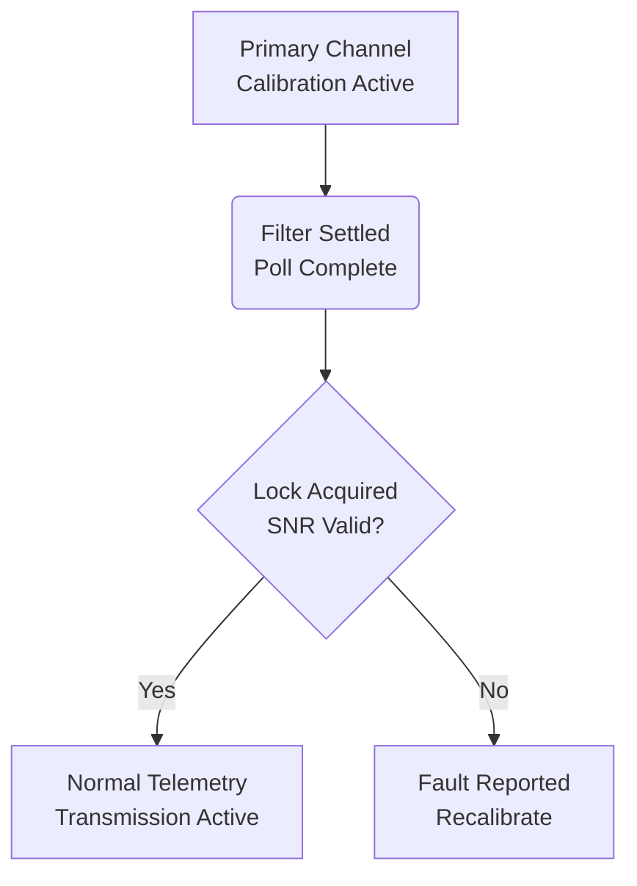

# Hardware Telemetry Calibration Specification

## 1. Overview
This specification details the calibration protocol for the optical telemetry subsystem.
All sensor outputs must satisfy baseline stability metrics before activating primary signal channels.

## 2. Telemetry Formulas & SNR Bounds
The primary channel power $P_{\text{primary}}$ and reference channel power $P_{\text{secondary}}$ are sampled simultaneously.
The signal-to-noise ratio is defined by:

$$
\text{SNR}_{\mathrm{measured}} = 10 \log_{10}\left(\frac{I_{\text{signal}}}{I_{\text{noise}}}\right) \ge 20\text{ dB}
$$

The logarithmic attenuation index is computed as $\log_2(\alpha)$ where $\alpha \ge 1.0$.

## 3. Calibration Steps
1. **Initial Calibration Step:**
   * Compute telemetry ratio:
     ```math
     \text{SNR}_{\mathrm{measured}} = 10 \log_{10}\left(\frac{I_{\text{signal}}}{I_{\text{noise}}}\right) \ge 20\text{ dB}
     ```
   * Verify register stability:
     $$\lvert \Delta y \rvert \le \text{cal_lock_zone_r}$$

2. **Secondary Phase Alignment:**
   * Evaluate power thresholds $P_{\text{primary}} \ge 0.85$ and $P_{\text{secondary}} \le 1.15$.

## 4. Subsystem State Flowchart


## 5. Metrics Table
| Channel | Target Power | Measured Power | Error Margin |
| :--- | :--- | :--- | :--- |
| Channel A | $P_a = 1.0\text{ mW}$ | $P_{\text{meas}} = 0.99\text{ mW}$ | $\pm 0.02\text{ mW}$ |
| Channel B | $P_b = 2.0\text{ mW}$ | $P_{\text{meas}} = 1.98\text{ mW}$ | $\pm 0.05\text{ mW}$ |
