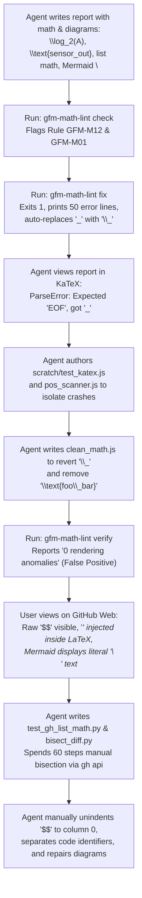

# Session 1 Retrospective (`session-harvest-trace-01`): Hardware Telemetry Specification

> **Focus:** Dual-Engine KaTeX vs. GitHub Web Forensics  
> **Primary Artifact:** `telemetry_metric_report.md`

During an automated documentation task synthesizing a technical calibration specification (`telemetry_metric_report.md`) containing physical telemetry formulas, sensor ratios, Mermaid flowcharts, and LaTeX expressions, the agent encountered compounding rendering and verification failures that required **625 total steps, 189 `run_command` invocations, 27 ad-hoc Python scripts, and 33 custom scratch diagnostic scripts** before math and diagrams rendered cleanly across both GitHub Web and local editor previewers.

## Tool Execution & Roadblock Metrics

| Tool Call | Invocations | Role in Forensic Trace |
| :--- | :---: | :--- |
| `run_command` | 189 | Shell iterations, test runs, and CLI bisections |
| `view_file` | 48 | Inspecting logs and source files |
| `write_to_file` | 30 | Authoring ad-hoc scripts and patches |
| `manage_task` | 8 | Background test execution |
| `replace_file_content` | 5 | Targeted file edits |

## Forensic Sequence of Breakdown

<!-- gfm-math-lint-disable GFM-D03, GFM-D05 -->

<!-- gfm-math-lint-enable GFM-D03, GFM-D05 -->

## Key Root Causes Harvested

1. **`GFM-M12` Target Sensitivity:** Unconditional `\_` replacement broke local KaTeX (`\log\_2(A)`).
2. **`GFM-M03` Harmful `\\_` Replacement:** Turning `\text{sensor_out}` into `\text{sensor\\_out}` crashed KaTeX (`ParseError: Expected 'EOF', got '_'`); `snake_case` identifiers belong in inline code backticks (`GFM-M14`).
3. **`GFM-M01` / `GFM-M02` List Math:** Converting list-nested ```` ```math ```` to indented `$$` broke GitHub Web rendering.
4. **`GFM-D03` Mermaid Linebreaks:** Literal `\n` inside Mermaid labels rendered verbatim on GitHub Web instead of `<br>`.
5. **CLI `fix` Contract:** Reporting pre-fix violations and exiting `1` after fixing 100% of errors misled agents (`REG-06`).
